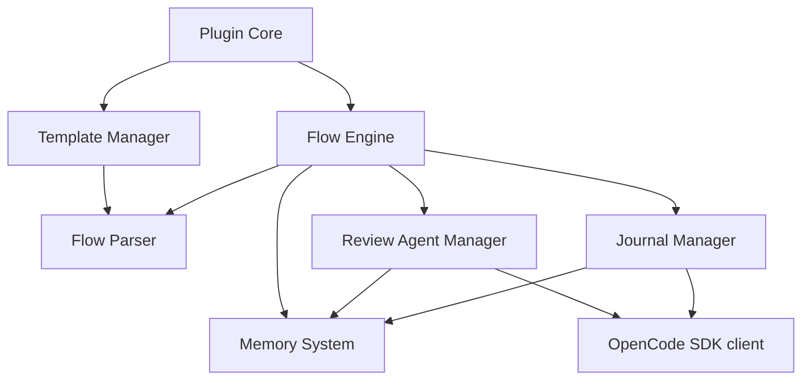
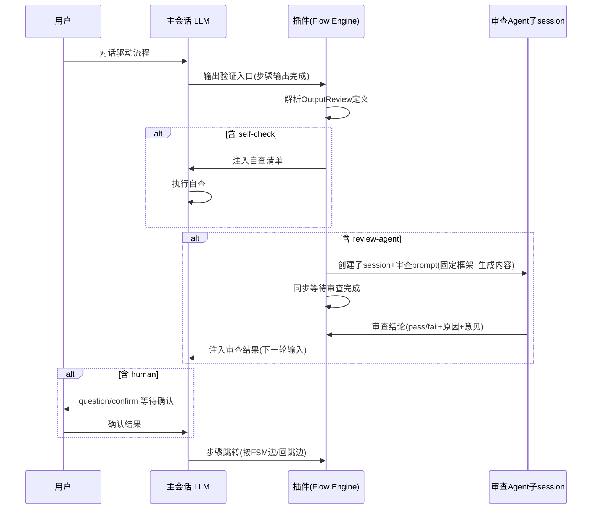
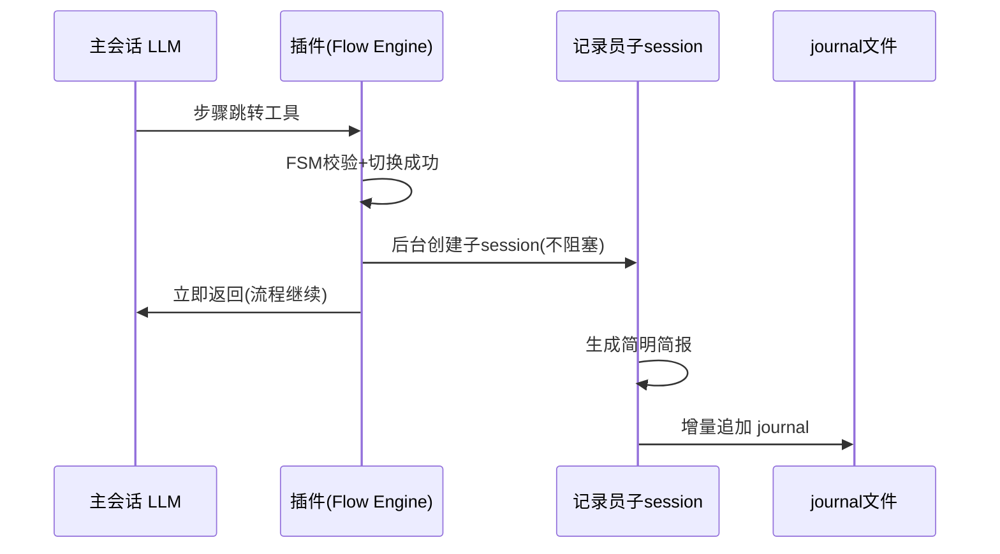
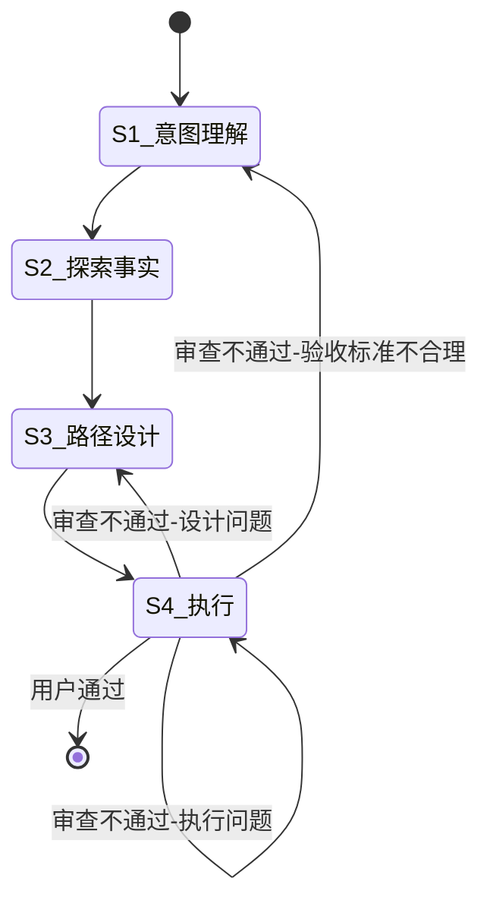
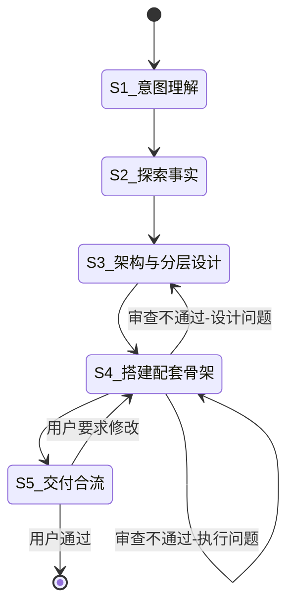
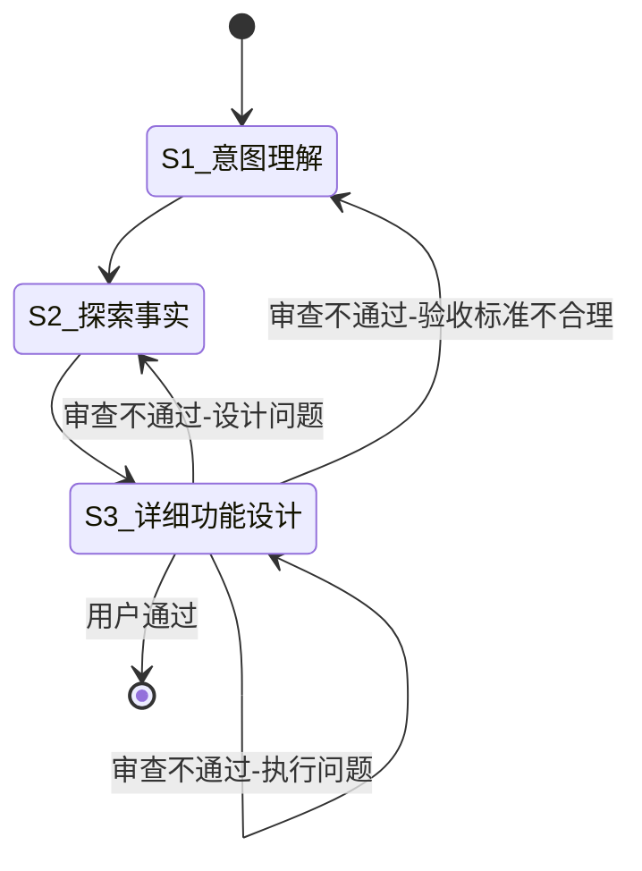
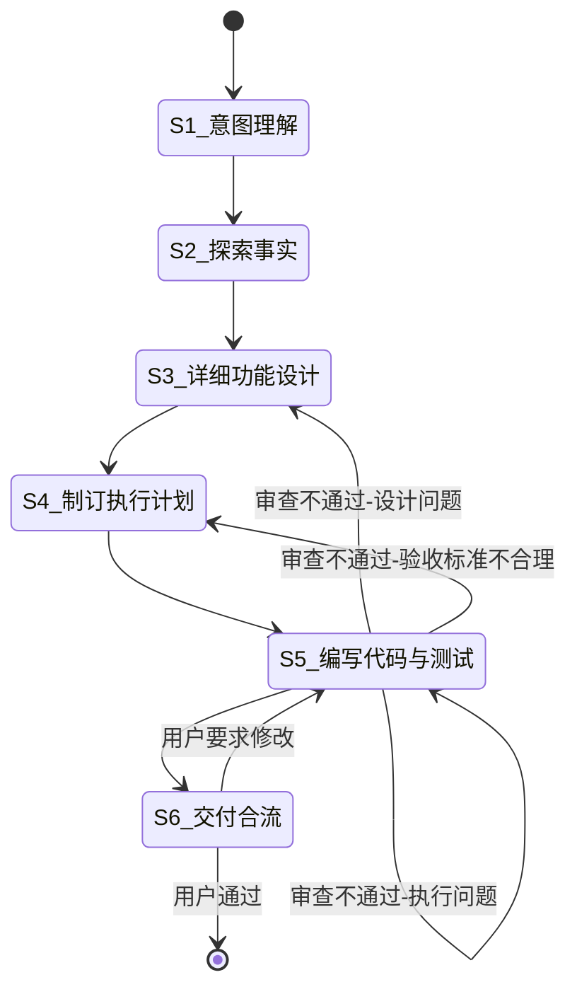
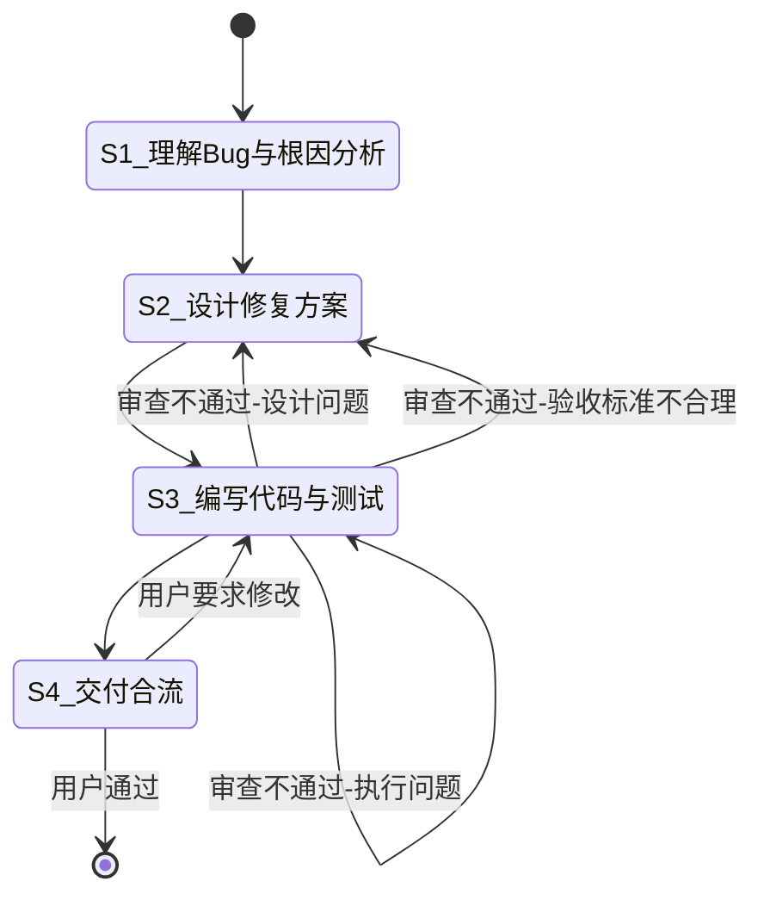
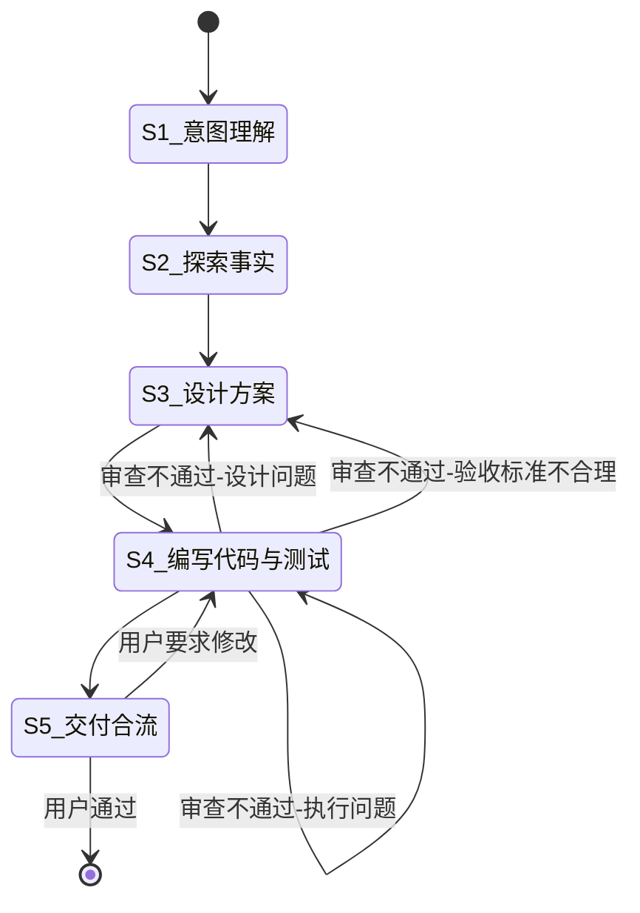
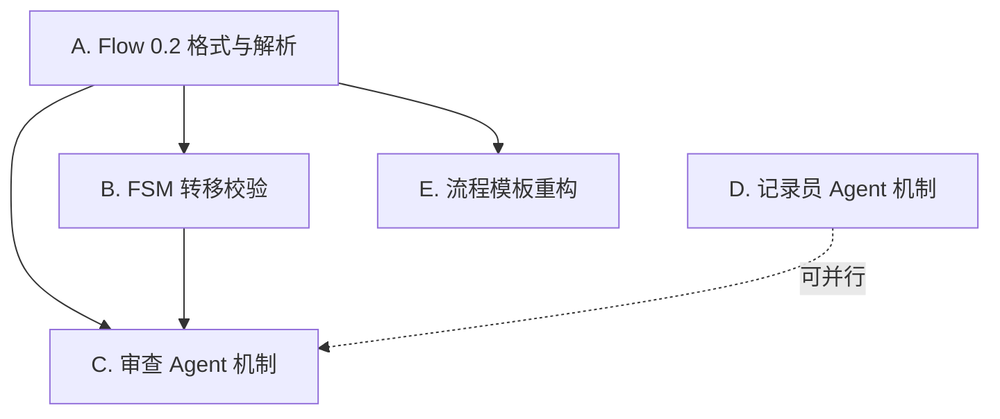

# vibe-pm 0.2 版本功能规格

**创建日期**: 2026-08-20
**状态**: Draft
**输入来源**: `docs/note/vibe-pm.xmind` "Vibe-PM-v0.2" sheet + 渐进式访谈（S4，10 题）+ 代码现状探索 + oh-my-openagent 调研

---

## 背景与需求

### 现状（0.1 版本能力基线）

0.1 版本已实现任务驱动的核心闭环：Flow 解析与上下文注入、FSM 步骤流转（LLM 自主判断）、SQLite 任务状态存储、Token 指标采集、TUI 面板、模板安装/卸载。但存在以下结构性问题：

1. **步骤输出无验证机制**——步骤是否完成、产出是否合格，完全依赖 LLM 自觉与流程 Markdown 中的提示词约定，插件层没有任何程序保证。Human-in-loop 只是提示词层面的「建议使用 question/confirm 工具」，可被 LLM 跳过。
2. **步骤跳转无程序校验**——`FlowEngine.setStep` 不校验目标步骤是否为 FSM 合法转移，LLM 可以任意跳步。
3. **无流程日志**——任务执行过程只有 SQLite 中的 `step_transitions` 结构数据（fromStep/toStep/at），缺少可读的过程日志（任务进展、用户决策、审查结论、理解偏差），事后复盘困难。
4. **无程序化审查能力**——0.1 的「审查」仅为流程文档中给 LLM 的提示（如「S7 自查」「S8 用户验收」），无后台审查 Agent、无「不通过回跳」机制。

### 0.2 目标

依据 xmind "Vibe-PM-v0.2" sheet 规划，0.2 版本围绕三大板块升级：

**板块 1：Flow 结构升级**

流程定义文档的「任务步骤」从「编号/名称/指令」升级为「编号/名称/输出/输出审查/引用规则」五要素：

- **输出**：每个 Step 的执行目标（如「Spec 文档」「工程骨架」「代码变更」）。
- **输出审查**：每步静态标注验证方式，三种可选——**自查**（self-check）、**审查 Agent**（review-agent）、**人工审查**（human），可组合（如「自查+审查Agent+人工」）。
  - 审查通过 → 进入下一步骤。
  - 审查不通过 → 判定原因（执行问题 / 设计问题 / 验收标准不合理）→ 按 FSM 静态定义的回跳边回跳指定步骤。

**板块 2：插件程序保证步骤行为**

- **记录员 Agent**：每次步骤切换时，插件在后台启动记录员子 session，将「任务进展简报 / 用户关键决策与反馈 / 审查总结 / 理解偏差与纠正」增量追加写入 `.vibe-pm/journal/{task_id}.md`。限制篇幅，不阻塞主流程。
- **审查 Agent**：对标注「审查 Agent」验证方式的步骤，插件在后台启动审查子 session（参考 oh-my-openagent 机制），主 Session 等待审查完成，拿到审查结果后继续流程；审查结果产出主流程下一轮输入。
- **步骤保证**：解析流程文档中的 mermaid FSM 图，程序校验步骤跳转是否合法（含审查不通过的回跳边）。

**板块 3：流程实例重构**

内置流程集合调整为 6 个（见「流程实例定义」章节）：

| 0.2 流程 | 关系 |
|----------|------|
| research | 保留，重构为 4 步 |
| arch-design | **新增**——由 design-spec 拆分扩展，定位「架构设计与项目冷启动」 |
| feat-design | **新增**——由 design-spec 拆分扩展，定位「单个功能模块设计」 |
| spec-driven-dev | 保留，重构为 6 步 |
| bug-fix | 保留，重构为 4 步 |
| side-job | 保留，重构为 5 步 |
| design-spec | **废弃**（职责由 arch-design + feat-design 承接） |
| large-refactor | **废弃移除** |

### 核心概念定义

> 以下概念来自 S4 访谈澄清（访谈结论以 📌 标注，作为设计决策的可追溯来源）。

- **输出 vs 交付物**：📌 *「输出是每个 Step 的执行目标，交付物是整个 Task 的交付目标」*
  - **输出**（Output）：步骤级，声明该步骤要达成什么。
  - **交付物**（Deliverable）：任务级，声明整个任务最终交付什么。
  - **交付标准**（Acceptance Standard）：任务级，声明交付物达到什么标准算完成。
- **默认值与覆盖**：📌 *「流程文档定义默认输出/交付物/交付标准，用户可以启动流程时重新指定交付物，在流程执行过程中，根据流程定义，LLM 需要再次向用户确认交付物和交付标准」*
  - 流程文档静态定义默认交付物与交付标准。
  - 任务启动时（`/pm-{flow}` 工具调用）用户可重新指定交付物。
  - 流程执行中（S1 意图理解步骤）LLM 需再次向用户确认交付物与交付标准。

### 术语

| 术语 | 定义 |
|------|------|
| 输出（Output） | 步骤级执行目标 |
| 交付物（Deliverable） | 任务级交付目标 |
| 交付标准（Acceptance Standard） | 交付物验收标准 |
| 输出审查（Output Review） | 步骤输出的验证环节 |
| 自查清单（Output Checklist） | 步骤级静态定义的自查条目列表，self-check 验证的依据 |
| 自查（self-check） | LLM 按自查清单对自身输出进行核对 |
| 审查 Agent（review-agent） | 插件启动的后台 LLM 子 session 审查 |
| 人工审查（human） | 用户通过 question/confirm 工具确认 |
| 记录员 Agent（journaler） | 步骤切换时后台写流程日志的 LLM 子 session |
| 回跳边（rollback edge） | FSM 中审查不通过时的转移边 |

---

## 用例场景

> 本 Spec 为流程系统设计（非交互式终端功能），用户故事形式不适用，改用「用例场景」描述系统行为。按优先级 P1/P2/P3 排列。

### 场景 P1-1：步骤输出通过审查 Agent 验证后进入下一步骤

**场景描述**：用户在 spec-driven-dev 任务中，LLM 完成 S5「编写代码与测试」后，该步骤标注的验证方式为「自查+审查Agent+人工」。

**流程**：

1. LLM 完成 S5 执行，先按审查清单自查（运行测试、LSP 诊断、代码审查）。
2. 自查通过后，LLM 声明 S5 输出完成（调用输出验证入口工具）。
3. 插件在后台启动审查 Agent 子 session，将 S5 的输出摘要、验收标准、审查原则注入审查 prompt。
4. 主 Session 等待审查 Agent 完成（同步等待）。
5. 审查 Agent 返回「通过」→ 审查结果注入主会话，LLM 继续执行「人工审查」环节（用户确认）→ 用户确认通过 → LLM 按 FSM 进入 S6 交付合流。

**独立验证方式**：运行一个 spec-driven-dev 任务到 S5，观察审查 Agent 被启动、审查结果回传、步骤流转正确。

### 场景 P1-2：审查不通过按判定原因回跳

**场景描述**：bug-fix 任务中 S3「编写代码与测试」的审查 Agent 判定不通过。

**流程**：

1. 审查 Agent 判定不通过，给出判定原因与修改意见。
2. 判定原因分类：
   - **执行问题** → 回跳重做本步骤（S3）。
   - **设计问题** → 回跳设计步骤（S2 设计修复方案）。
   - **验收标准不合理** → 回跳确认验收标准的步骤（S2）。
3. 回跳目标由该流程 FSM 图静态定义的回跳边决定，程序校验跳转合法性。
4. LLM 按回跳边调用步骤跳转，主流程进入回跳目标步骤重新执行。

**独立验证方式**：构造一个审查不通过的场景，观察回跳目标与 FSM 回跳边一致，跳转校验通过。

### 场景 P1-3：步骤切换时记录员 Agent 后台写日志

**场景描述**：任意任务中，LLM 从 S2 跳转到 S3。

**流程**：

1. LLM 调用步骤跳转工具，程序校验合法后步骤切换成功。
2. 插件触发记录员流程：在后台创建记录员子 session（不阻塞主会话），输入为步骤变更点后的会话内容。
3. 记录员生成简明简报（任务进展、用户关键决策、审查总结、理解偏差与纠正），增量追加到 `.vibe-pm/journal/{task_id}.md`。
4. 主会话流程不受影响，继续执行新步骤。

**独立验证方式**：执行步骤切换后检查 journal 文件是否追加了新条目，且主会话未因记录员而停顿。

### 场景 P2-1：任务启动时重指定交付物

**场景描述**：用户执行 `/pm-research` 时附带自定义交付物说明。

**流程**：

1. 启动工具接收可选的交付物参数。
2. 任务创建时保存用户指定的交付物（覆盖流程文档默认值）。
3. S1 意图理解步骤中，LLM 向用户再次确认交付物与交付标准（展示默认值或用户已指定值）。

**独立验证方式**：启动任务时传入交付物参数，观察 S1 确认环节展示的是用户指定值。

### 场景 P2-2：非法步骤跳转被警告

**场景描述**：LLM 试图从 S1 直接跳到 S5（跳过中间步骤，FSM 中无此边）。

**流程**：

1. 程序解析流程 FSM 图获得合法转移边。
2. LLM 调用步骤跳转工具，目标步骤不在合法转移集合中。
3. 程序不阻断跳转，但返回警告信息（提示合法转移集合），LLM 可修正跳转或说明理由。
4. 无 mermaid 图或解析失败时降级为无校验模式。

**独立验证方式**：构造非法跳转调用，观察警告返回与合法转移提示。

### 场景 P3-1：审查 Agent 不可用时降级

**场景描述**：审查 Agent 启动失败（宿主环境异常）。

**流程**：插件记录失败原因，向主会话注入提示：「审查 Agent 启动失败，请执行加强版自查，并提示用户本步骤的人工审查更为重要」。流程不中断。

**独立验证方式**：模拟审查 Agent 启动失败，观察降级提示与流程继续。

---

## 设计

### 模块与职责

| 模块 | 职责 | 依赖 | 暴露 |
|------|------|------|------|
| Flow Parser（新） | 解析 flow.md 的 0.2 格式：步骤元数据（编号/名称/输出/输出审查/引用规则）+ mermaid FSM 图 → 结构化 FlowDefinition | 文件系统 | FlowDefinition、解析错误 |
| Flow Engine（扩展） | 步骤流转、FSM 转移校验、审查/记录员触发编排、交付物确认上下文注入 | Memory System、Flow Parser | setStep（含校验）、verifyOutput、getFlowDefinition |
| Review Agent Manager（新） | 审查 Agent 子 session 启动、同步等待、结果解析与回传、失败降级 | OpenCode SDK client、Flow Engine | startReview、review 结果 |
| Journal Manager（新） | 记录员子 session 调度（fire-and-forget）、journal 文件增量追加、篇幅约束 | OpenCode SDK client、Memory System | appendJournal（内部触发） |
| Template Manager（扩展） | 0.2 格式模板装载、新流程模板（arch-design/feat-design）、废弃模板（design-spec/large-refactor）清理 | Flow Parser | 现有接口不变，新增模板清单 |
| Memory System（复用/扩展） | 任务状态存储；新增审查记录与 journal 元数据 | — | 现有 CRUD + 审查记录 |
| Plugin Core（扩展） | 新工具注册（输出验证入口）、启动工具交付物参数 | 上述模块 | pm_task_verify 等工具 |



### 领域模型

| 实体 | 属性 | 关系 |
|------|------|------|
| FlowDefinition | flow 名、Template ID、Command、步骤列表、转移边集合 | 1 对多 FlowStep；1 对多 TransitionEdge |
| FlowStep | 编号、名称、目标、输出（步骤执行目标）、自查清单（Output Checklist）、输出审查（验证方式组合）、引用规则、指令内容 | 属于 FlowDefinition |
| OutputReview | 验证方式列表（self-check / review-agent / human）、回跳映射（判定原因 → 目标步骤） | 属于 FlowStep；self-check 方式引用 FlowStep 的自查清单 |
| TransitionEdge | 起点步骤、终点步骤、条件标签（自动/用户确认/审查不通过-原因） | 属于 FlowDefinition |
| ReviewResult | 审查结论（通过/不通过）、判定原因（执行问题/设计问题/验收标准不合理）、审查意见、产出下一轮输入 | 关联 FlowStep 与 Task |
| JournalEntry | 任务 ID、步骤变更点、简报内容、时间戳 | 关联 Task |
| Task（扩展） | 现有属性 + 交付物（用户指定值，可空）、交付标准 | 关联 FlowDefinition |

### 数据流

#### 审查 Agent 数据流

**触发**：LLM 完成某步骤输出，该步骤验证方式包含 review-agent，LLM 调用输出验证入口。

| 阶段 | 模块 | 输入数据 | 动作 | 输出数据 |
|------|------|----------|------|----------|
| 1 | Flow Engine | 步骤 ID、任务上下文 | 读取 FlowStep 的 OutputReview 定义与验收标准 | 审查请求 |
| 2 | Review Agent Manager | 审查请求 | 创建审查子 session（parentID 关联主会话），注入固定框架+生成内容 prompt | 子 session ID |
| 3 | Review Agent Manager | 子 session ID | 同步等待审查完成 | 审查输出文本 |
| 4 | Review Agent Manager | 审查输出文本 | 解析为结构化 ReviewResult | ReviewResult |
| 5 | Flow Engine | ReviewResult | 通过 → 注入主会话继续流程；不通过 → 按判定原因查回跳边，指导 LLM 跳转 | 流转决策 |

#### 记录员 Agent 数据流

**触发**：`setStep` 成功切换步骤后。

| 阶段 | 模块 | 输入数据 | 动作 | 输出数据 |
|------|------|----------|------|----------|
| 1 | Flow Engine | 步骤变更（fromStep/toStep） | 步骤切换成功后触发记录员 | 记录请求 |
| 2 | Journal Manager | 记录请求、步骤变更点后的会话消息 | 后台创建记录员子 session（fire-and-forget） | 子 session ID |
| 3 | Journal Manager | 记录员输出简报 | 增量追加写入 journal 文件 | `.vibe-pm/journal/{task_id}.md` |

### 接口设计

#### Flow 文档 0.2 格式

> 本接口为流程作者面向的文档格式约定，非代码接口。0.2 格式在 0.1 基础上新增「默认交付物与交付标准」区块，并为每个步骤增加「Output」「Output Checklist」「Output Review」字段。

**Flow 级结构元素**：

| 区块 | 必填 | 说明 |
|------|:----:|------|
| 文档头 MetaData | 是 | Template ID / Category / Description / Command / Version |
| 适用场景 | 是 | 适用与不适用场景描述 |
| 输入要求 | 是 | 任务启动时需要的输入项 |
| 默认交付物与交付标准 | 是 | 任务级默认值（交付物、交付标准）；用户启动时可重新指定 |
| 状态机（FSM mermaid 图） | 是 | 正常转移边 + 审查不通过回跳边 |
| 任务步骤 | 是 | 各步骤的完整定义（见下表） |

**Step 级结构元素**：

| 字段 | 必填 | 约束 | 说明 |
|------|:----:|------|------|
| 编号（`### S{n}: {名称}`） | 是 | 从 S1 开始连续编号 | 步骤标题 |
| **Goal** | 是 | 一句话 | 步骤目标 |
| **Output** | 是 | 交付物类型描述 | 步骤执行目标（如「Spec 文档」「工程骨架」） |
| **Output Checklist** | 条件必填 | 验证方式含 `self-check` 时必填；否则标注「—」 | 自查条目列表，self-check 的依据 |
| **Output Review** | 是 | 枚举组合 | 格式：`self-check` / `review-agent` / `human`，可 `+` 组合 |
| **Referenced Regulation** | 否 | 文件路径列表 | 引用规则 |
| 指令列表 | 是 | 有序列表 | 步骤执行指令 |
| **Upon completion** | 是 | 转移条件描述 | 与 FSM 图转移边一致 |

FSM mermaid 图扩展约定：审查不通过的回跳边必须在 mermaid 图中显式定义，边标签格式 `审查不通过-{判定原因}`。

**完整范例**（以 side-job 流程为样本）：

```markdown
# 快速任务

**Template ID**: `side-job`
**Category**: quick
**Description**: 快速周转任务（执行前必须确认方案）
**Command**: `/pm-side-job`
**Version**: 2.0.0

---

## 适用场景

- 小范围、明确的任务（单个文件修改、简单功能调整）

**不适用**：涉及多模块的大任务（使用 spec-driven-dev）。

---

## 输入要求

| 输入项 | 必填 | 说明 |
|--------|------|------|
| 任务描述 | 是 | 要做什么 |

---

## 默认交付物与交付标准

- 代码变更 + 测试通过

> 任务启动时用户可重新指定交付物；S1 中 LLM 需再次与用户确认交付物与交付标准。

---

## 状态机

（此处为 FSM mermaid 状态图，含正常转移边与「审查不通过-{判定原因}」回跳边，格式见本 Spec「流程实例定义」章节）

---

## 任务步骤

### S1: 意图理解

**Goal**: 准确理解任务意图与交付要求
**Output**: 明确的任务意图 + 确认后的交付物与交付标准
**Output Checklist**: —
**Output Review**: human
**Referenced Regulation**: —

1. 阅读用户的任务描述
2. 提取核心意图
3. 展示交付物与交付标准（用户启动时已指定则展示指定值，否则展示默认值），使用 confirm 工具与用户确认

**Upon completion**: 自动进入 S2

---

### S2: 探索事实

**Goal**: 建立任务所需的知识基线
**Output**: 已知事实清单
**Output Checklist**: —
**Output Review**: human
**Referenced Regulation**: —

1. 搜索项目内相关代码与文档
2. 汇总已知事实

**Upon completion**: 自动进入 S3

---

### S3: 设计方案

**Goal**: 产出经确认的设计方案
**Output**: 设计方案（含验收标准）
**Output Checklist**:
- 方案覆盖任务描述的全部要点
- 方案符合项目既有模式
- 验收标准明确可验证
- 无超出任务范围的改动
**Output Review**: self-check + human
**Referenced Regulation**: —

1. 确认设计偏好（向用户确认技术选型/实现方式偏好）
2. 确认验收标准
3. 编写设计方案

**Upon completion**: 用户确认方案 → 自动进入 S4

---

### S4: 编写代码与测试

**Goal**: 按确认方案实现代码并通过测试
**Output**: 代码变更 + 测试结果
**Output Checklist**:
- LSP 诊断零 error
- 构建通过
- 测试全部通过
- 无类型逃逸（any / @ts-ignore）
- 变更范围与方案一致
**Output Review**: self-check + review-agent + human
**Referenced Regulation**: constitution.md, coding_style.md

1. 按方案实现
2. 运行验证（LSP 诊断 / 构建 / 测试）

**Upon completion**: 审查通过 → 自动进入 S5

---

### S5: 交付合流

**Goal**: 用户验收交付物并结束任务
**Output**: 验收结论 + 任务关闭
**Output Checklist**: —
**Output Review**: human
**Referenced Regulation**: —

1. 展示交付物与交付标准对照
2. confirm 等待用户验收
3. 询问 git commit
4. 任务关闭

**Upon completion**: 用户通过 → 任务结束
```

#### 输出验证入口（新工具）

| 方面 | 详情 |
|------|------|
| **Role** | LLM 声明某步骤输出完成，请求执行该步骤标注的验证流程 |
| **Owner** | Plugin Core |
| **Consumed By** | 流程执行中的 LLM（主会话） |

**输入**：

| 参数 | 类型 | 必填 | 约束 | 默认 |
|------|------|:----:|------|------|
| 无（作用于当前任务当前步骤） | — | — | 需存在活跃任务 | — |

**输出**：

| 字段 | 类型 | 描述 |
|------|------|------|
| review-required | 布尔值 | 是否需要审查 Agent 验证 |
| self-check-checklist | 文本列表 | 自查清单（来自流程文档该步骤的 Output Checklist，无则空） |
| result | 枚举 | 验证结论（通过/不通过/等待审查中） |

**错误情况**：

| 条件 | 错误 | 消息 | 恢复 |
|------|------|------|------|
| 无活跃任务 | 任务不存在 | 当前无活跃任务 | 用户启动任务 |
| 当前步骤未声明输出审查 | 无验证定义 | 当前步骤未定义输出审查 | 按流程文档确认 |

#### 任务启动工具（扩展：交付物参数）

| 方面 | 详情 |
|------|------|
| **Role** | 启动流程任务时接收可选的交付物重指定 |
| **Owner** | Plugin Core |

**输入**（在现有启动工具参数基础上新增）：

| 参数 | 类型 | 必填 | 约束 | 默认 |
|------|------|:----:|------|------|
| deliverable | 文本 | 否 | 自由文本描述 | 流程文档默认交付物 |
| acceptance-standard | 文本 | 否 | 自由文本描述 | 流程文档默认交付标准 |

#### 审查 Agent 启动（内部接口）

| 方面 | 详情 |
|------|------|
| **Role** | 启动审查子 session 并同步等待结果 |
| **Owner** | Review Agent Manager |

**输入**：

| 参数 | 类型 | 必填 | 约束 | 默认 |
|------|------|:----:|------|------|
| parent-session-id | 文本 | 是 | 主会话 ID | — |
| step-output-summary | 文本 | 是 | 待审查步骤的输出摘要 | — |
| acceptance-standard | 文本 | 是 | 该步骤验收标准 | — |
| review-framework | 文本 | 是 | 固定审查框架 prompt | 内置默认框架 |

**输出**：

| 字段 | 类型 | 描述 |
|------|------|------|
| conclusion | 枚举 | pass / fail |
| fail-reason | 枚举 | 执行问题 / 设计问题 / 验收标准不合理（仅 fail 时） |
| feedback | 文本 | 审查意见与修改建议 |
| next-input | 文本 | 产出主流程下一轮输入（审查结论简报） |

**错误情况**：

| 条件 | 错误 | 消息 | 恢复 |
|------|------|------|------|
| 子 session 创建失败 | 启动失败 | 审查 Agent 启动失败，转为加强自查+人工审查 | 降级模式 |
| 审查超时 | 超时 | 审查超时，请人工确认 | 转人工审查 |

#### 记录员 Agent（内部接口）

| 方面 | 详情 |
|------|------|
| **Role** | 步骤切换后后台生成并追加流程日志 |
| **Owner** | Journal Manager |

**输入**：

| 参数 | 类型 | 必填 | 约束 | 默认 |
|------|------|:----:|------|------|
| task-id | 文本 | 是 | 任务 ID | — |
| from-step / to-step | 文本 | 是 | 步骤变更 | — |
| recent-messages | 文本 | 是 | 步骤变更点后的会话消息（截断） | — |

**输出**：无（fire-and-forget；结果直接落盘 journal 文件）

**错误情况**：

| 条件 | 错误 | 消息 | 恢复 |
|------|------|------|------|
| journal 目录不存在 | 文件系统错误 | 自动创建目录 | 自动恢复 |
| 记录员子 session 启动失败 | 启动失败 | 静默降级（记录到插件日志，不打扰主流程） | 下次切换重试 |

### 内部逻辑

#### FSM 解析与转移校验

**触发**：流程文档加载、`setStep` 调用。

**步骤**：

1. 解析流程文档 mermaid `stateDiagram-v2` 代码块。
2. 提取状态节点（形如 `S{n}_名称`）与转移边（`A --> B: 条件标签`）。
3. 构建合法转移集合：正常边（自动/用户确认）+ 回跳边（`审查不通过-{原因}` 标签）。
4. `setStep` 时校验目标步骤是否在「当前步骤的出边集合」中。
5. IF 合法 THEN 执行切换 ELSE 返回警告（含合法转移列表），不阻断。
6. 解析失败（无 mermaid 图/语法异常）→ 降级为无校验模式，并在任务上下文中提示。

**决策表**：

| 条件 | 输入状态 | 动作 | 输出状态 |
|------|----------|------|----------|
| 目标步骤 = 当前步骤 | 已在该步骤 | 幂等返回 | 不变 |
| 目标步骤 ∈ 合法出边 | 转移合法 | 记录退出/进入、追加 step_transitions、触发记录员 | 新步骤 |
| 目标步骤 ∉ 合法出边 | 转移非法 | 警告+提示合法集合 | 不变（LLM 可修正） |
| FSM 解析失败 | 无校验模式 | 直接切换 | 新步骤 |

#### 审查流程

**触发**：LLM 调用输出验证入口，且当前步骤验证方式含 review-agent。

**步骤**：

1. 读取当前步骤 OutputReview 定义、验收标准与 Output Checklist（自查清单）。
2. IF 验证方式含 self-check THEN 注入该步骤的 Output Checklist，LLM 逐项核对并声明自查结论。
3. IF 验证方式含 review-agent THEN：
   a. 构造审查 prompt = 固定框架（通用审查原则） + 生成内容（步骤输出摘要 + 验收标准 + 任务上下文）。
   b. 创建审查子 session（parentID = 主会话 ID），发送审查 prompt，同步等待。
   c. 解析审查结果为结构化 ReviewResult。
   d. IF pass THEN 注入「通过+审查意见」进主会话 → 进入下一步骤 ELSE 注入「不通过+判定原因+修改意见」→ 查 FSM 回跳边 → LLM 按回跳边跳转。
4. IF 验证方式含 human THEN 提示 LLM 使用 question/confirm 工具等待用户确认。

**决策表**：

| 审查结论 | 判定原因 | 回跳目标 | 产出 |
|----------|----------|----------|------|
| pass | — | 下一步骤（FSM 正常边） | 审查简报注入主会话 |
| fail | 执行问题 | 本步骤（重做） | 修改意见注入主会话 |
| fail | 设计问题 | 设计步骤（FSM 回跳边） | 修改意见注入主会话 |
| fail | 验收标准不合理 | 确认验收标准的步骤（FSM 回跳边） | 修改意见注入主会话 |

#### 记录员流程

**触发**：`setStep` 切换成功后。

**步骤**：

1. 收集记录输入：步骤变更（from/to）、变更点后的会话消息（含用户消息与 LLM 回复）。
2. 后台创建记录员子 session（fire-and-forget，不阻塞主会话）。
3. 记录员按四类内容生成简明简报：任务进展简报、用户关键决策与反馈、审查总结、理解偏差与纠正。篇幅约束：每类 1-3 行。
4. 增量追加到 `.vibe-pm/journal/{task_id}.md`（首次写入自动创建目录与文件，文件头含任务元信息）。
5. 失败静默降级，不打扰主流程。

### 交互设计

#### 审查 Agent 时序



#### 记录员 Agent 时序



### 可配置项

| 配置项 | 默认值 | 描述 |
|--------|:------:|------|
| journal 目录 | `.vibe-pm/journal` | 流程日志存放目录 |
| 审查 Agent 模型 | 继承插件主模型配置 | 审查子 session 使用的模型 |
| 记录员 Agent 模型 | 继承插件主模型配置 | 记录员子 session 使用的模型 |
| 审查超时时间 | 10 分钟 | 同步等待超时阈值 |
| 审查 Agent 固定框架 prompt | 内置默认框架 | 可覆盖的通用审查原则 |
| 记录员每次输入消息上限 | 最近 20 条消息 | 记录员输入的会话截断窗口 |

---

## 流程实例定义

> 依据 xmind "Vibe-PM-v0.2" sheet 的 6 个流程实例骨架 + S4 访谈裁决（编号连续化）。「输出验证」列即每步的 Output Review 静态标注；各步骤的完整 Output Checklist 与指令详情在 Phase 4 编写流程模板时按 0.2 格式（见「Flow 文档 0.2 格式」章节）补充。

### research（4 步）

| 步骤 | 名称 | 输出 | 输出验证 |
|------|------|------|----------|
| S1 | 意图理解 | 明确的任务意图 + **确认交付物与交付标准** | 人工 |
| S2 | 探索事实 | 知识基线（已知事实清单） | 人工 |
| S3 | 路径设计 | 执行路径规划（确认设计偏好后产出） | 人工 |
| S4 | 执行 | 指定交付物 | 人工 |



> research 无独立「交付合流」步骤，S4 的人工验证承担交付确认职责（交付物验收 + git commit 询问 + 任务关闭）。

### arch-design（5 步，新流程）

定位：**架构设计与项目冷启动**（承接 design-spec 的架构设计职责）。

| 步骤 | 名称 | 输出 | 输出验证 |
|------|------|------|----------|
| S1 | 意图理解 | 明确的架构设计意图 + 确认交付物与交付标准 | 人工 |
| S2 | 探索事实 | 知识基线 | 人工 |
| S3 | 架构与分层设计 | Spec 文档（确认设计偏好后产出） | 人工 |
| S4 | 搭建配套骨架 | 工程骨架（确认设计偏好后产出） | 自查+人工 |
| S5 | 交付合流 | 交付物验收与任务关闭 | 人工 |



### feat-design（3 步，新流程）

定位：**单个功能模块设计**（承接 design-spec 的功能设计职责）。

| 步骤 | 名称 | 输出 | 输出验证 |
|------|------|------|----------|
| S1 | 意图理解 | 明确的功能设计意图 + 确认交付物与交付标准 | 人工 |
| S2 | 探索事实 | 知识基线 | 人工 |
| S3 | 详细功能设计 | 功能设计产出（确认设计偏好后产出） | 自查+人工 |



> feat-design 无独立「交付合流」步骤，S3 的人工验证承担交付确认职责。

### spec-driven-dev（6 步）

| 步骤 | 名称 | 输出 | 输出验证 |
|------|------|------|----------|
| S1 | 意图理解 | 明确的开发意图 + 确认交付物与交付标准 | 人工 |
| S2 | 探索事实 | 知识基线 | 人工 |
| S3 | 详细功能设计 | 功能设计（确认设计偏好后产出） | 自查+人工 |
| S4 | 制订执行计划 | 执行计划（确认验收标准后产出） | 自查+人工 |
| S5 | 编写代码与测试 | 代码变更与测试 | 自查+审查Agent+人工 |
| S6 | 交付合流 | 交付物验收与任务关闭 | 人工 |



### bug-fix（4 步）

| 步骤 | 名称 | 输出 | 输出验证 |
|------|------|------|----------|
| S1 | 理解 Bug 与根因分析 | Bug 理解 + 根因分析结论 | 人工 |
| S2 | 设计修复方案 | 修复方案（确认设计偏好+验收标准后产出） | 自查+人工 |
| S3 | 编写代码与测试 | 代码变更与测试 | 自查+审查Agent+人工 |
| S4 | 交付合流 | 交付物验收与任务关闭 | 人工 |



### side-job（5 步）

| 步骤 | 名称 | 输出 | 输出验证 |
|------|------|------|----------|
| S1 | 意图理解 | 明确的意图 + 确认交付物与交付标准 | 人工 |
| S2 | 探索事实 | 知识基线 | 人工 |
| S3 | 设计方案 | 设计方案（确认设计偏好+验收标准后产出） | 自查+人工 |
| S4 | 编写代码与测试 | 代码变更与测试 | 自查+审查Agent+人工 |
| S5 | 交付合流 | 交付物验收与任务关闭 | 人工 |



### 交付合流步骤统一职责

适用于含该步骤的流程（arch-design、spec-driven-dev、bug-fix、side-job）：

1. 汇总任务全部产出，展示交付物与交付标准对照。
2. 使用 confirm 工具等待用户验收（用户不通过 → 按 FSM 回跳边返回）。
3. 用户通过后，使用 question 工具询问是否执行 git commit。
4. 调用任务关闭（`pm_task_close`）结束任务并触发分析。

---

## 边界与错误处理

| 场景 | 预期行为 |
|------|----------|
| 流程文档无 mermaid FSM 图 | 降级为无校验模式，任务上下文提示「该流程未定义 FSM，跳转不校验」 |
| mermaid 语法解析失败 | 同降级模式，记录解析错误到插件日志 |
| 步骤跳转目标非法 | 警告 + 返回合法转移集合，不阻断（LLM 可修正） |
| 审查 Agent 子 session 创建失败 | 降级为加强自查 + 人工审查，注入提示，流程不中断 |
| 审查同步等待超时 | 转人工审查，注入提示 |
| 审查结果解析失败（非预期格式） | 按「不通过-执行问题」保守处理，附原始审查文本 |
| journal 目录不存在 | 首次写入时自动创建 |
| 记录员子 session 启动失败 | 静默降级，插件日志记录，主流程不受影响 |
| 步骤切换与记录员竞态（连续快速切换） | 记录员任务按触发顺序排队，晚完成者仍增量追加（时间戳区分） |
| 无活跃任务时调用输出验证入口 | 返回错误提示，不做任何写操作 |
| 验证方式含 self-check 但步骤未定义 Output Checklist | 解析时告警；验证时提示 LLM 按验收标准自行拟定核对要点 |
| 用户启动任务时交付物参数为空 | 使用流程文档默认交付物 |
| 旧格式流程文档（0.1 无 Output 字段） | 解析为「无输出审查定义」，验证入口按步骤未定义处理；不阻塞旧流程使用 |

## 验收标准

| # | 场景 | Given | When | Then |
|---|:----:|-------|------|------|
| 1 | P1-1 | spec-driven-dev 任务运行至 S5 完成 | LLM 调用输出验证入口 | 审查 Agent 子 session 启动、同步等待、结果注入主会话、按 FSM 进入 S6 |
| 2 | P1-2 | bug-fix 任务 S3 审查判定「设计问题」 | 审查结果返回 | LLM 按回跳边跳转 S2，跳转校验通过 |
| 3 | P1-3 | 任务执行中步骤从 S2 切换到 S3 | 切换成功 | journal 文件追加新简报条目，主会话未被阻塞 |
| 4 | P2-1 | 用户以自定义交付物启动任务 | S1 确认环节执行 | LLM 展示用户指定交付物与交付标准 |
| 5 | P2-2 | LLM 发起非法跳转 | 调用步骤跳转工具 | 返回警告与合法转移集合，状态不变 |
| 6 | P3-1 | 审查 Agent 启动失败 | 输出验证执行 | 注入降级提示，流程继续，转人工审查 |
| 7 | P1-1 | 流程文档为 0.2 格式 | 插件加载流程 | FlowDefinition 结构化解析成功（步骤/输出/审查/FSM 边齐全） |
| 8 | P1-3 | 任务关闭后 | 用户查看 journal 文件 | 文件包含任务全程四类日志内容，篇幅简明 |
| 9 | — | 六个内置流程安装 | 逐一启动任务 | 各流程按新步骤结构执行，编号连续无跳号 |
| 10 | — | 旧模板 design-spec/large-refactor 已安装 | 执行清理 | 模板库中不再出现（或标注废弃） |

## 约束与限制

### 技术约束

- OpenCode SDK（`@opencode-ai/plugin` 1.17.x）提供 `session.create`（parentID 父子关联）、`session.prompt`（同步等待）、`session.promptAsync`（fire-and-forget）原语——审查 Agent 用同步等待，记录员用 fire-and-forget。SDK 无「插件 hook 直接 spawn 子 agent」能力，子 session 调度需插件自行编排（oh-my-openagent 同模式）。
- `session.idle` 事件存在但 0.2 不依赖它（审查走同步等待，无需 idle 检测）。
- mermaid 图解析需自实现轻量解析器（仅解析本项目约定的 `stateDiagram-v2` 子集：状态声明、`-->` 边、边标签、note），不引入完整 mermaid 渲染库。
- 审查与记录员子 session 的工具白名单受限：禁止子 session 再次启动子流程（防递归）。

### 业务约束

- 流程文档是流程行为的唯一权威定义——程序不得硬编码任何流程步骤（宪法/AGENTS.md 反模式）。
- `docs/template/` 内置模板的 Template ID 不可修改（安装/卸载唯一标识）。
- 审查 Agent 与记录员 Agent 均不向用户提问（`question` 工具禁用），只输出结论文本。
- journal 文件在 `.vibe-pm/` 下，沿用现有 gitignore 排除，不纳入版本控制。

### 已知风险

| 风险 | 概率 | 影响 | 缓解 |
|------|------|------|------|
| 同步等待审查期间主会话超时/用户中断 | 中 | 中 | 设置审查超时阈值，超时转人工 |
| 多子 session 并发对宿主性能的压力 | 中 | 中 | 记录员限篇幅+截断输入窗口；审查串行化（同一任务同一时刻至多一个审查） |
| mermaid 解析器覆盖不全（用户自定义流程用了高级语法） | 中 | 低 | 解析失败降级无校验模式，不阻断 |
| 审查 Agent 结论质量不稳定 | 中 | 中 | 固定框架强化审查原则；失败保守处理 |
| promptAsync 竞态（记录员连续触发） | 低 | 低 | 排队串行化+时间戳追加 |

### 影响范围

- **扩展**：`src/engine/`（Flow Engine 增加校验与编排）、`src/template/`（0.2 格式）、`src/core/`（新工具与启动参数）、`src/memory/`（审查记录/jourmal 元数据）。
- **新增**：Flow Parser、Review Agent Manager、Journal Manager 三个模块。
- **不修改**：Token 指标采集、TUI 面板、i18n 架构（仅新增提示文案）。

---

## 分解方案

### 规模评估结论

本需求涉及 4 个以上独立模块（Flow 格式与解析、审查 Agent、记录员 Agent、6 个流程模板重构），预估实现周期超过 1 个 sprint，且子功能间存在明确先后依赖（审查机制依赖 FSM 解析；流程模板重构依赖 0.2 格式）→ **需要分解，分 Phase 实施**。

### 子模块列表

| 子模块 | 职责边界 | 交付物 |
|--------|----------|--------|
| A. Flow 0.2 格式与解析 | 流程文档格式约定、步骤结构化解析、FSM mermaid 解析 | Flow Parser 模块 + 格式文档 |
| B. FSM 转移校验 | setStep 合法转移校验、降级策略 | Flow Engine 扩展 + 测试 |
| C. 审查 Agent 机制 | 审查子 session 调度、同步等待、结果解析回传、降级 | Review Agent Manager + 输出验证入口工具 |
| D. 记录员 Agent 机制 | 记录员调度、journal 文件写入 | Journal Manager + journal 文件 |
| E. 流程模板重构 | 6 个内置流程按 0.2 格式重写 + 2 新流程 + 2 废弃清理 + 启动参数 | 模板文件 + 启动工具扩展 |

### 依赖关系



### 分步实施顺序

| Phase | 子模块 | MVP 定义（本 Phase 交付后可独立验证什么） |
|-------|--------|------------------------------------------|
| Phase 1 | A + B | 安装任意 0.2 格式流程后，插件可结构化解析步骤与 FSM；非法跳转被警告；旧流程不受影响 |
| Phase 2 | C | 对标注 review-agent 的步骤，输出验证入口可启动审查子 session、同步等待、回传结果；不通过时按回跳边跳转 |
| Phase 3 | D | 步骤切换后 journal 文件自动追加简报，主会话无感知 |
| Phase 4 | E | 6 个内置流程以 0.2 格式开箱即用；arch-design/feat-design 可安装启动；design-spec/large-refactor 清理；启动时可指定交付物 |

---

## 实施计划

> 本节在开发过程中持续更新。以下为初始里程碑规划。

### [ ] Milestone 1 — Phase 1: Flow 0.2 格式与 FSM 校验

- [ ] 定义 0.2 格式约定并更新 `docs/template/flow-template.md`
- [ ] 实现 Flow Parser（步骤元数据 + mermaid FSM 子集解析）
- [ ] FlowEngine.setStep 接入转移校验与降级策略
- [ ] 单元测试：解析正确性、非法跳转警告、降级路径
  - 已知风险：mermaid 子集解析器的边界定义（note 块、多行标签）

### [ ] Milestone 2 — Phase 2: 审查 Agent 机制

- [ ] 输出验证入口工具注册
- [ ] Review Agent Manager（子 session 创建、同步等待、结果解析）
- [ ] 固定审查框架 prompt 设计（通用审查原则）
- [ ] 审查结果注入与回跳编排
- [ ] 降级路径（启动失败/超时/解析失败）
  - 已知风险：同步等待期间主会话体验；审查 prompt 质量需迭代调优

### [ ] Milestone 3 — Phase 3: 记录员 Agent 机制

- [ ] Journal Manager（子 session 调度、目录管理、增量追加）
- [ ] 记录员简报 prompt 设计（四类内容、篇幅约束）
- [ ] setStep 触发接入（fire-and-forget）
  - 已知风险：连续快速切换的排队处理

### [ ] Milestone 4 — Phase 4: 流程模板重构

- [ ] 6 个内置流程按 0.2 格式重写（research/arch-design/feat-design/spec-driven-dev/bug-fix/side-job）
- [ ] arch-design、feat-design 新模板（含步骤指令详情）
- [ ] design-spec、large-refactor 废弃处理（模板库移除与已安装清理策略）
- [ ] 启动工具交付物参数扩展
- [ ] 端到端集成测试
  - 已知风险：新流程步骤指令细节需结合实践迭代

---

## 待决策项

| # | 待决策项 | 说明 |
|---|----------|------|
| 1 | 废弃模板的已安装实例清理策略 | 用户已安装 design-spec/large-refactor 的项目，卸载提示 or 静默保留？ |
| 2 | 审查 Agent 固定框架 prompt 的最终文本 | 需在 Phase 2 实现时起草并迭代 |
| 3 | 输出验证入口的工具命名与形态 | 候选：独立工具 vs 复用现有步骤跳转工具的增强参数 |
