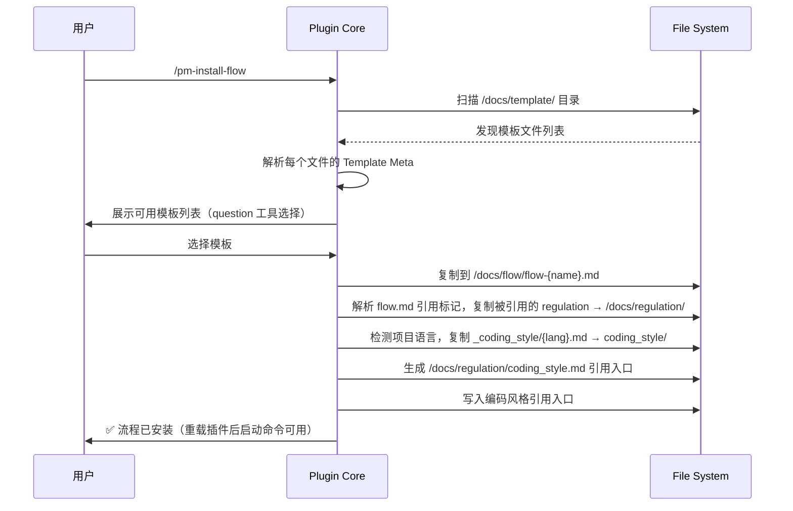
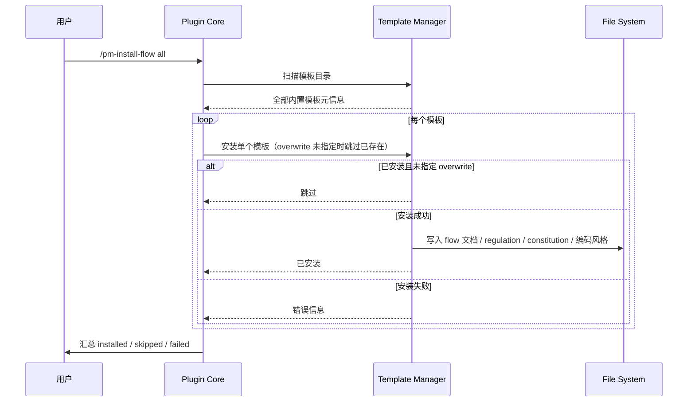
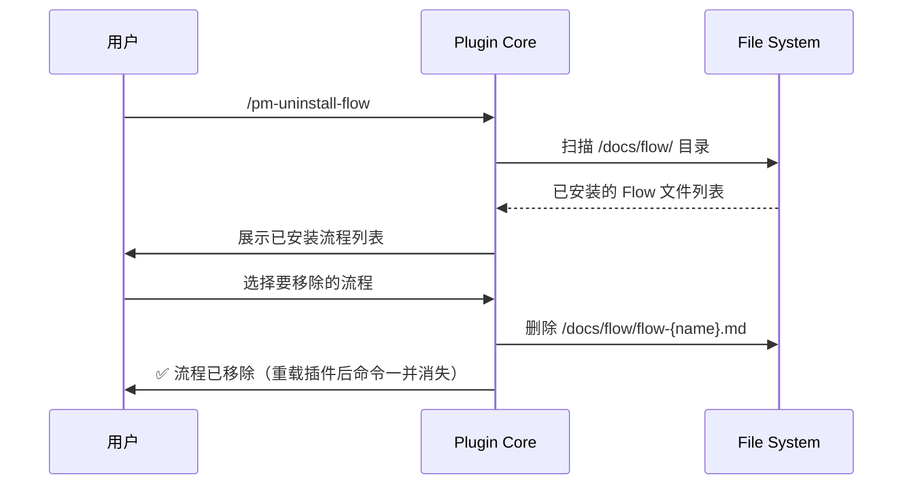

# Template Manager Spec

**创建日期**: 2026-06-11
**状态**: Implemented
**输入来源**: XMind 设计文档 + 用户反馈
**最后更新**: 2026-10-21 — 新增 `/pm-install-flow all` 批量安装子命令；修正内置模板清单与命令注册机制的过时描述

---

## 需求背景

vibe-pm 发布时**内置一批开箱即用的流程模板文件**。`/pm-install-flow` 命令只需按约定目录路径 `/docs/template/` 扫描模板文件，让用户选择后复制到 `/docs/flow/` 即可。无需额外的接口抽象层——路径约定即接口。

---

## 设计要点

### 约定路径

| 路径 | 用途 |
|------|------|
| `/docs/template/` | 内置模板存放目录（发布时自带） |
| `/docs/flow/` | 用户已安装的流程存放目录 |

### 模板文件格式

每个模板文件是一个完整的 Flow 文档（按 `flow-document-format.md` 规范），文件头标注模板元信息：

```markdown
# {模板名称}

**Template ID**: `{kebab-case-id}`
**Category**: {research / development / maintenance}
**Description**: {一句话描述}
**Command**: `/pm-{command-name}`
**Version**: 1.0.0

---

## 适用场景
...

## 状态机
...

## 任务步骤
...
```

### `/pm-install-flow` 工作流



### `/pm-install-flow all` 子命令

除按 ID 安装单个模板外，支持一次性安装 `docs/template/` 下的**全部内置 flow 模板**。

#### 接口定义

工具 `pm_install_flow` 的输入参数：

| 参数 | 类型 | 必填 | 说明 |
|------|------|------|------|
| `all` | boolean | 否 | 为 `true` 时进入批量安装模式，安装全部内置 flow 模板 |
| `templateId` | string | 否 | 单个模板 ID。与 `all` 互斥；`all=true` 时该参数被忽略 |
| `programmingLanguages` | string | 否 | 逗号分隔的语言列表，批量模式与单个模式共用同一套语言解析与配置回写逻辑 |
| `overwrite` | boolean | 否 | 默认 `false`。批量模式下为 `false` 时跳过已安装的模板；为 `true` 时覆盖全部已安装模板 |

用户输入 `/pm-install-flow all` 时，命令层负责把 `all` 映射为工具参数 `all: true`，而非 `templateId: "all"`。`all` 不是合法模板 ID，也不构成模板 ID 的保留字。

#### 批量安装语义

| 决策点 | 规则 |
|--------|------|
| 集合来源 | `scanTemplates` 的完整返回集合。判定规则为「模板目录下存在 `flow.md` 的子目录」，工具目录（`_coding_style`、`_regulation`）与平铺的非 flow 模板文件天然被排除 |
| 跳过策略 | 目标 `docs/flow/flow-{id}.md` 已存在且未指定 `overwrite` → 跳过该模板，计入汇总的 skipped，不写任何文件。这保护了用户可能已手工修改的 flow |
| 覆盖策略 | 指定 `overwrite: true` 时，批量模式沿用与单个模式相同的覆盖语义，覆盖全部已安装的模板 |
| 跳过判定归属 | 「已存在则跳过」是**单个模板安装函数的可选行为**，由调用方显式开启；不开启时维持原有的冲突即报错语义。两个调用方（单模板命令、批量安装）共用同一条安装路径 |
| 失败策略 | 单个模板安装抛错 → 捕获错误后继续安装剩余模板，该模板计入 failed（携带模板 ID 与失败原因）。批量安装不中断、不回滚 |
| 失败回滚 | 单个模板内部：flow 文档写入后若后续步骤（regulation / constitution / 编码风格）失败，删除刚写入的 flow 文档再抛出错误。否则下次运行会把它判为「已安装」而永久跳过，剩余步骤永远补不上 |
| 目标路径被占用 | 若 `docs/flow/flow-{id}.md` 被**目录等非文件条目**占用，安装报冲突错误并说明「被非文件条目占用」，而不是让底层的 EISDIR 错误直接逃逸。已安装的判定是「存在且为普通文件」 |
| 顺序 | 按 `scanTemplates` 返回顺序处理，不做额外排序 |
| 幂等性 | 重复执行 `/pm-install-flow all` 无副作用：第二次全部落入 skipped |

#### 批量安装输出

批量安装的输出为一次汇总，包含三段明细：

| 字段 | 含义 |
|------|------|
| `installed` | 本次新安装成功的模板 ID 列表 |
| `skipped` | 因已安装而跳过的模板 ID 列表 |
| `failed` | 安装失败的条目列表，每项包含模板 ID 与失败原因 |

输出文案由**专用的多语言字典项**生成（中英文各一条），不复用单个安装的文案项 —— 单个安装的 `templateId` 是单值语义，无法承载三段计数。批量文案与单个安装文案保持一致，都会提示重启 OpenCode 后新命令生效。

#### 批量安装时序



> **命令注册时机**：flow 对应的命令在插件加载时由运行时扫描 `docs/flow/` 动态注册，因此批量安装完成后需重载插件，新命令才会出现。批量文案与单个安装文案均包含重启提示。

---

### `/pm-uninstall-flow` 工作流



> 卸载只删除 flow 文档本身。对应的启动命令由插件加载时扫描 `docs/flow/` 动态注册，重载插件后自然消失，无需（也无法）单独清理命令文件。

### Command 动态注册

安装 Flow **不生成**任何命令文件。`docs/flow/` 下的 Flow 文档在插件加载时被扫描，其中 `**Command**:` 字段即为注册的命令名（如 `/pm-bug-fix` → 命令 `pm-bug-fix`），用户可直接用该命令启动 Flow 下的任务。

- 命令描述由命令名与 flow 文件名推导（文件名去掉 `flow-` 前缀即 flow 名）
- Flow 文档没有 `**Command**:` 字段 → 不注册命令，仅作为文档存在
- 插件内置命令（如 `/pm-install-flow`）与 Flow 命令走两条独立的注册路径，互不影响

> **设计原则**：不需要 `ITemplateManager` 接口抽象层。Plugin Core 的命令实现直接按约定路径读写文件。

---

## 内置模板清单

6 个现役模板（`docs/template/` 下含 `flow.md` 的子目录）：

| Template ID | 名称 | Category | Command | 版本 |
|-------------|------|----------|---------|------|
| `research` | Research Task | research | `/pm-research` | 0.3.0 |
| `feat-design` | Feature Design | design | `/pm-feat-design` | 0.3.0 |
| `bug-fix` | Bug Fix | maintenance | `/pm-bug-fix` | 0.3.0 |
| `arch-design` | Architecture Design | development | `/pm-arch-design` | 0.3.0 |
| `spec-driven-dev` | Spec-Driven Development | development | `/pm-spec-driven-dev` | 0.3.0 |
| `side-job` | Quick Turnaround Tasks | side-job | `/pm-side-job` | 0.3.0 |

`/pm-install-flow all` 安装的集合即为上表全集。

### 模板完成状态

| 模板 | 状态 | 文件 |
|------|------|------|
| research | ✅ 已完成 | `docs/template/research/flow.md` |
| feat-design | ✅ 已完成 | `docs/template/feat-design/flow.md` |
| bug-fix | ✅ 已完成 | `docs/template/bug-fix/flow.md` |
| arch-design | ✅ 已完成 | `docs/template/arch-design/flow.md` |
| spec-driven-dev | ✅ 已完成 | `docs/template/spec-driven-dev/flow.md` |
| side-job | ✅ 已完成 | `docs/template/side-job/flow.md` |

> 早期的 `new-feature`、`large-refactor` 两个模板 ID 已分别更名为 `feat-design`、`arch-design`；旧 ID 不再保留。

### 模板 Bundle 结构

```
docs/template/{template-id}/
├── flow.md                ← Flow 文档（含 Template Meta）
└── regulations/           ← 配套 Regulation（可选）
    └── *.md
```

### 编码风格模板结构

```
docs/template/_coding_style/   ← 语言编码风格模板目录（发布时自带）
├── typescript.md
├── python.md
├── go.md
├── rust.md
├── java.md
└── general.md
```

安装时：根据 `detectProjectLanguages()` 检测到的语言，将对应文件复制到 `/docs/regulation/coding_style/` 目录，并生成 `/docs/regulation/coding_style.md` 引用入口文件。

安装时：`flow.md` → `/docs/flow/flow-{id}.md`，`regulations/*.md` → `/docs/regulation/`。

### XMind 各流程步骤对照

**新功能开发**（重任务开发）：
```
S1 理解输入意图 → S2 探索已知事实 → S3 标记缺口与矛盾 →
S4 [Human-in-loop] 渐进式访谈 → S5 设计方案与计划 →
S6 [Human-in-loop] 审查计划 → S7 编写代码 → S8 编写测试 →
S9 运行测试修复 → S10 检查清单自查 → S11 生成交付报告 →
S12 [Human-in-loop] 用户验收 → S13 合流
```

**Bug 修复**：
```
S1 理解Bug描述 → S2 分析根因给出修复方案 →
S3 [Human-in-loop] 审查计划 → S4 编写代码 → S5 编写测试 →
S6 运行测试修复 → S7 检查清单自查 → S8 生成交付报告 →
S9 [Human-in-loop] 用户验收 → S10 合流
```

**大规模重构**：
```
S1 理解重构意图 → S2 探索现有代码 → S3 标记影响范围与风险 →
S4 [Human-in-loop] 渐进式访谈 → S5 设计方案与迁移路径 →
S6 [Human-in-loop] 审查计划 → S7 编写代码（保持向后兼容） →
S8 编写迁移测试 → S9 运行测试修复 → S10 兼容性验证 →
S11 检查清单自查 → S12 生成交付报告 →
S13 [Human-in-loop] 用户验收 → S14 合流

---

## 测试用例

### template-scan.test.ts

- **测试文件**: `tests/template/template-scan.test.ts`
- **关联设计文档**: `vibe-pm-template-manager.md`
- **Setup/Teardown**: 创建临时项目目录，放入含 `flow.md` 的模板子目录；创建空 `/docs/flow/` 目录

| 动作指令 | 测试方法 | Given | When | Then | Notes |
|----------|----------|-------|------|------|-------|
| 保留 | `scan_finds_all_templates` | 模板目录下有 3 个合法 bundle | 扫描目录 | 返回 3 个模板 | 目录扫描 |
| 保留 | `scan_parses_meta` | 模板含 Template ID / Category / Command | 扫描目录 | 元信息字段正确解析 | 元信息解析 |
| 保留 | `scan_skips_non_template_dirs` | 模板目录下有无 flow.md 的目录 | 扫描目录 | 无 flow.md 的目录被排除 | 工具目录排除 |
| 保留 | `install_copies_to_flow_dir` | 选中模板 | 执行安装 | /docs/flow/ 下出现同名文件，内容一致 | 文件复制 |
| 保留 | `install_copies_regulations` | flow.md 引用了配套 Regulation | 执行安装 | Regulation 被复制到 /docs/regulation/ | 引用精确复制 |
| 保留 | `install_does_not_overwrite_existing_regulation` | Regulation 已存在 | 执行安装 | 已存在文件内容不变 | 保护人工修改 |
| 保留 | `install_overwrite_error` | /docs/flow/ 已有同名 Flow，未传 overwrite | 执行安装 | 抛 TemplateConflictError | 冲突处理 |
| 保留 | `install_overwrite_force` | 同上，overwrite=true | 执行安装 | 安装成功 | 强制覆盖 |
| 保留 | `uninstall_removes_file` | /docs/flow/ 下有 2 个 Flow | 移除 1 个 | 目标被删除，另一个保留 | 卸载 |
| 保留 | `list_installed_flows` | /docs/flow/ 下有已安装 Flow | 列举 | 返回去前缀的 flow 名 | 已安装列表 |
| 保留 | `scanTemplates_fallback_to_plugin` | 项目无模板目录 | 扫描 | 回退到插件内置模板目录 | 目录回退 |
| 保留 | `scanTemplates_prioritizes_project` | 项目与插件均有模板 | 扫描 | 以项目模板为准 | 优先级 |
| 保留 | `codingStyle_*` | 指定 / 未指定语言 | 安装 | 仅复制指定语言；缺省回退 General | 编码风格安装 |

### command-generation.test.ts

- **测试文件**: `tests/template/command-generation.test.ts`
- **关联设计文档**: `vibe-pm-template-manager.md`
命令文件机制已废弃（改为插件加载时扫描 `docs/flow/` 动态注册命令）。该测试文件转为**反向锁定**「安装与卸载都不再产出 / 操作命令文件」。

- **测试文件**: `tests/template/command-generation.test.ts`
- **关联设计文档**: `vibe-pm-template-manager.md`

| 动作指令 | 测试方法 | Given | When | Then | Notes |
|----------|----------|-------|------|------|-------|
| 保留 | `parse_meta_includes_command` | 模板含 Command 字段 | 扫描模板 | TemplateMeta.command 正确解析 | 命令字段仍需解析（动态注册依赖它） |
| 保留 | `parse_meta_no_command` | 模板不含 Command 字段 | 扫描模板 | TemplateMeta.command = "" | 缺失字段降级 |
| 保留 | `install_does_not_generate_command_file` | 含 Command 字段的模板 | 安装 | 不生成任何命令文件 | 反向锁定 |
| 保留 | `install_without_command_skips_file` | 不含 Command 字段的模板 | 安装 | 不生成任何命令文件 | 反向锁定 |
| 保留 | `uninstall_no_longer_touches_command_file` | 已安装的 Flow | 卸载 | 仅删除 flow 文档 | 反向锁定 |

### install-all.test.ts

- **测试文件**: `tests/template/install-all.test.ts`（新增）
- **关联设计文档**: `vibe-pm-template-manager.md`「`/pm-install-flow all` 子命令」
- **Setup/Teardown**: 创建临时项目目录，放入多个模板 bundle 与空 `/docs/flow/` 目录

| 动作指令 | 测试方法 | Given | When | Then | Notes |
|----------|----------|-------|------|------|-------|
| 新增 | `install_all_installs_every_template` | 模板目录下有 N 个模板 | 批量安装 | N 个 flow 文档全部写入 | 全量安装 |
| 新增 | `install_all_skips_existing` | 其中 1 个 flow 已安装 | 批量安装（未传 overwrite） | 已存在文件内容不变，计入 skipped | 跳过策略 |
| 新增 | `install_all_overwrites_when_forced` | 其中 1 个 flow 已安装 | 批量安装且 overwrite=true | 文件被覆盖，计入 installed | 覆盖策略 |
| 新增 | `install_all_continues_after_failure` | 某模板的目标路径 `docs/flow/flow-{id}.md` 被同名目录占用 | 批量安装 | 该模板复制失败进入 failed，其余模板仍安装成功 | 失败不中断（扫描阶段的读取失败属扫描期错误，不在本用例范围） |
| 新增 | `install_all_is_idempotent` | 刚完成一次批量安装 | 再次批量安装 | installed 为空，全部进入 skipped | 幂等性 |
| 新增 | `install_all_reports_three_buckets` | 混合已存在 / 新装 / 失败 | 批量安装 | 汇总含 installed / skipped / failed 三段明细 | 输出结构 |
| 新增 | `install_all_ignores_template_id` | 同时传 all=true 与 templateId | 批量安装 | 行为等同只传 all=true | 参数互斥（该用例属工具层，实现在 `tests/core/commands.test.ts`） |
| 新增 | `install_all_leaves_no_half_installed_template` | 某模板自带 regulation 文件不可读 | 批量安装两次（中途恢复权限） | 第一次该模板进 failed 且**不留残留文件**，第二次能正常装上 | 失败回滚 |
| 新增 | `non_file_entry_reports_a_readable_conflict` | 目标路径被同名目录占用 | 单个安装 | 抛 TemplateConflictError，消息含「non-file entry」，而非 EISDIR | 可读错误 |
| 新增 | `failed_install_rolls_back_the_flow_document` | flow 文档写入后后续步骤失败 | 单个安装 | flow 文档被删除，不留半装状态 | 失败回滚 |
| 新增 | `install_all_returns_empty_summary_when_no_templates_exist` | 模板目录为空 | 批量安装 | 返回全空汇总，不抛错 | 空集合 |

---

## 实施规划

> 本部分在开发过程中持续更新。以里程碑为粒度拆解，每个里程碑关联功能点和风险。

### [x] 里程碑 1 — Template Manager MVP

- [x] 模板扫描与安装：`/pm-install-flow` → 约定路径 `docs/template/` → 复制到 `docs/flow/`
  - 已知问题/风险: regulations 安装改为按 flow.md 引用标记精确复制，不再全量复制 bundleDir/regulations/
- [x] dictionary 模板安装已移至 `/pm-config init` 流程，`installTemplate` 不再处理
- [x] 模板卸载：`/pm-uninstall-flow` → 删除 flow 文件
  - 已知问题/风险: 卸载流程不处理 regulations 文件清理（仅清理 flow）
- [x] Command 注册改为插件加载时扫描 `docs/flow/` 动态注册（原 `.opencode/commands/{cmd}.md` 文件生成机制已废弃）
- [x] DCP 保护配置自动写入（`writeDcpConfig` — protectTags + protectedFilePatterns）
- [x] 编码风格模板安装（语言检测 + 13 种语言别名映射 + `_coding_style/` 复制 + 引用入口生成）
- [x] 内置模板扩充至 6 个：research、feat-design、bug-fix、arch-design、spec-driven-dev、side-job

### [x] 里程碑 2 — 批量安装（`/pm-install-flow all`）

- [x] 工具 `pm_install_flow` 新增 `all` 布尔参数，与 `templateId` 互斥
- [x] 模板管理器提供批量安装能力：逐个安装 + 三段汇总（installed / skipped / failed）
- [x] 默认跳过已安装的 flow（保护人工修改）；显式 `overwrite` 时覆盖
- [x] 单模板失败不中断整批，失败原因进入汇总
- [x] 批量输出使用专用的中英文多语言文案项
- [x] 命令层 prompt 与工具描述补写 `all` 的映射规则，避免 LLM 把它当模板 ID 透传
  - 已知问题/风险: 批量安装后新命令需重载插件才注册（与单个安装行为一致，不额外提示）
- [x] 实现期加固（代码审查后补做）:
  - 单模板安装的原子性：flow 文档写入后后续步骤失败则回滚该文档，避免下次运行误判为「已安装」
  - 目标路径被目录占用时报可读的冲突错误，不再让 EISDIR 逃逸
  - 批量与单模板共用「安装上下文准备」与「翻译清单生成」两个 helper，消除重复

### [ ] 已知待办（本次范围外）

- [ ] `docs/flow/` 下模板库已删除的残留流程（`design-spec`、`plan`）无人回收 —— `/pm-install-flow` 只进不出，清理入口仅 `/pm-uninstall-flow` 手动删；且 `.gitignore` 的 `/docs/flow/**.md` 让它们对 git 隐形
- [ ] `scripts/build-tui.ts` 拷贝模板到 `dist/docs/template` 前未清空目标目录，已删除的模板会残留在构建产物中；项目 `docs/template/` 缺失时回退扫描可能重新捞到废弃模板
