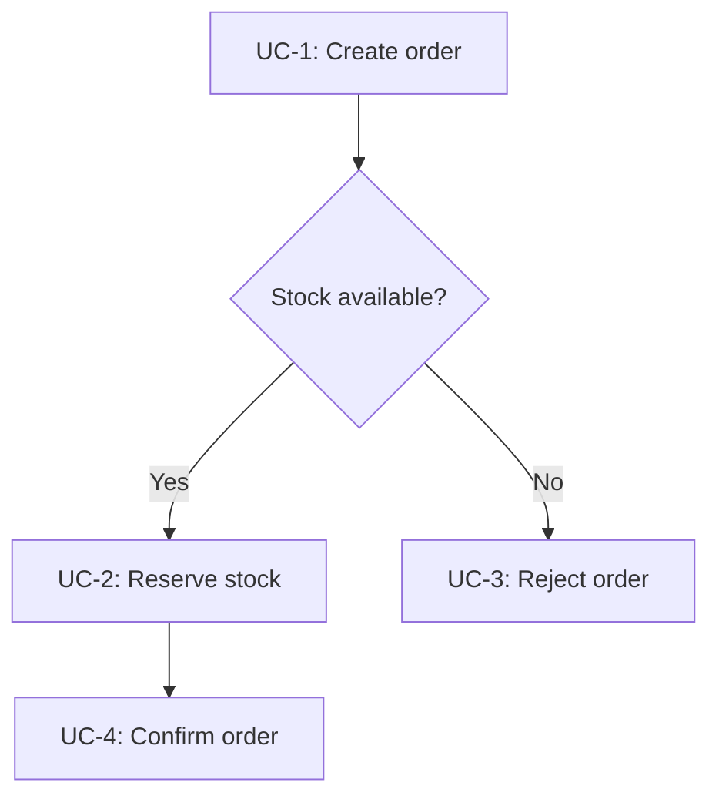
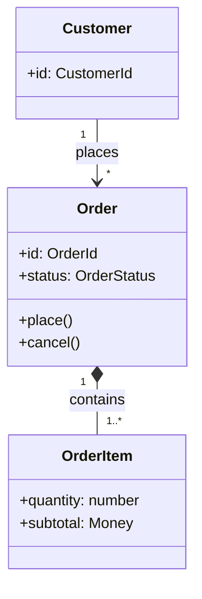

# Feature Spec Template

## Usage

When creating a new Feature Spec, follow the structure of this template, output to `/docs/spec/{feature-name}.md`, and fill in each section accordingly. Sections not applicable to the current feature may be removed.

For non-code-oriented features (process design, architecture design, rule definition, etc.), tailor the sections as appropriate.

---

# {Feature Title}

**Created Date**: {YYYY-MM-DD}
**Status**: Draft / Review / Final
**Input Source**: {User Request / Design Discussion / Technical Proposal / Task Requirement}

---

## Background & Requirements

<!-- Describe the target problem to solve, and the consequences of not solving it -->

{Background Description}

---

## Use Cases & User Stories

<!--
  User stories are ordered by priority (P1/P2/P3).
  Each user story must be independently testable and independently deliverable.
  P1 = core value; even if only this one is implemented, it should form a usable MVP.
  For non-interactive features (e.g., architecture, process, rules), user stories can be omitted;
  use "Use Case Scenarios" to describe system behavior instead.
  User stories describe value; Use Case Scenarios describe continuous/branching behavior.
  They complement each other and can be used together.
-->

### User Story 1 — {Title} (Priority: P1)

{Brief description of the user journey}

**Priority Reason**: {Why it is P1}

**Independent Verification**: {How to independently test this story — e.g., "After running xxx command, xxx output should appear"}

**Acceptance Scenarios**:

1. **Given** {initial state}, **When** {action}, **Then** {expected result}
2. **Given** {initial state}, **When** {action}, **Then** {expected result}

---

### User Story 2 — {Title} (Priority: P2)

{Brief description of the user journey}

**Priority Reason**: {Why it is P2}

**Independent Verification**: {How to independently test this story}

**Acceptance Scenarios**:

1. **Given** {initial state}, **When** {action}, **Then** {expected result}

---

### User Story 3 — {Title} (Priority: P3)

{Brief description of the user journey}

**Priority Reason**: {Why it is P3}

**Independent Verification**: {How to independently test this story}

**Acceptance Scenarios**:

1. **Given** {initial state}, **When** {action}, **Then** {expected result}

---

### Use Case Scenarios

<!--
  Describe continuous, branching, or stateful behavior as scenarios.
  Use a Mermaid flowchart to connect the scenarios and show their association logic.
  Keep scenario IDs (UC-1, UC-2, ...) stable so Acceptance Criteria can trace back to them.
  The diagram uses concrete example names; replace them when writing a real Spec.
-->

| Scenario | Trigger / Precondition | Main Flow | Branches | Postcondition |
|----------|------------------------|-----------|----------|---------------|
| UC-1 | {What starts the scenario} | 1. {Step} 2. {Step} | {condition} → UC-2; {condition} → UC-3 | {Resulting state} |
| UC-2 | {…} | {…} | {…} | {…} |

---

## Design

### Modules & Responsibilities

<!--
  Define clear ownership boundaries. Every piece of logic must belong to exactly one module.
  A module exposes interfaces; consumers only depend on those interfaces, not internals.
-->

| Module | Responsibility | Depends On | Exposes |
|--------|---------------|------------|---------|
| {Module A} | {What this module owns — its unique job} | {Module B, External Service C} | {Interface X, Interface Y} |
| {Module B} | {What this module owns} | — | {Interface Z} |

> Use a Mermaid diagram to show module relationships if the dependency graph is non-trivial.

---

### Domain Model

<!--
  Describe core entities/concepts and their relationships with a Mermaid classDiagram.
  Show key attributes, key behavior (methods), and relationship cardinalities.
  The diagram uses concrete example names; replace them when writing a real Spec.
  Add the optional table only for invariants or constraints the diagram cannot express clearly.
-->

| Entity | Responsibility | Key Invariants |
|--------|---------------|----------------|
| {Entity Name} | {What it represents / owns} | {Rules that must always hold} |

---

### Data Flow

<!--
  Describe how data enters the system, flows through modules, and exits.
  Answer: what triggers the flow? what input data is consumed? what output is produced?
-->

**Trigger**: {What event or condition initiates this flow}

**Input** → **Processing** → **Output**:

| Stage | Module | Input Data | Action | Output Data |
|-------|--------|------------|--------|-------------|
| 1 | {Module A} | {Raw input — type, format} | {What it does} | {Transformed data — type, format} |
| 2 | {Module B} | {Data from stage 1} | {What it does} | {Final output — type, format} |

---

### Interface Design

<!--
  Each interface must clearly define: what goes in, what comes out, and what can go wrong.
  Use a separate sub-section for each interface.
-->

#### {Interface Name}

| Aspect | Detail |
|--------|--------|
| **Role** | {What this interface does, in one sentence} |
| **Owner** | {Module that owns this interface} |
| **Consumed By** | {Modules or external systems that call this interface} |

**Input**:

| Parameter | Type | Required | Constraints | Default |
|-----------|------|:--------:|-------------|---------|
| {name} | {type / enum} | Yes/No | {range, format, length limit, allowed values} | {value} |

**Output**:

| Field | Type | Description |
|-------|------|-------------|
| {name} | {type} | {what this field means} |

**Error Cases**:

| Condition | Error | Message | Recovery |
|-----------|-------|---------|----------|
| {When does this happen} | {Error type/code} | {User-facing message} | {What the caller should do} |

---

### Internal Logic

<!--
  Describe how each module processes input to produce output.
  Use step-by-step descriptions or pseudocode — no implementation code.
-->

#### {Logic Unit Name}

**Trigger**: {What initiates this logic}

**Steps**:

1. {Step 1 — describe action, not code}
2. IF {condition} THEN {branch action} ELSE {alternative action}
3. {Step 3}

**Decision Table** (if applicable):

| Condition | Input State | Action | Output State |
|-----------|-------------|--------|--------------|
| {When} | {State A} | {What happens} | {State B} |

---

### Interaction Design

<!-- User-system interaction flow, key interface layouts, or operation sequences -->

> Optionally use Mermaid sequence diagrams to describe interactions

---

### Configurable Items

| Config Item | Default Value | Description |
|-------------|:-------------:|-------------|
| {key} | {value} | {description} |

---

## Decomposition Index

<!--
  Use this section when the Spec scope is too large to describe all details in a single document.
  "Design" retains only the layered architecture (modules, domain model, data flow, critical interfaces);
  detailed designs for individual feature points are decomposed into independent Specs.
  Remove this comment and table when not applicable.
-->

| Feature Point | Detailed Spec | Description |
|---------------|---------------|-------------|
| {Feature Point Name} | [`spec-{name}.md`](./{parent-feature}/spec-{name}.md) | {Brief description} |

---

## Edge Cases & Error Handling

| Scenario | Expected Behavior |
|----------|-------------------|
| {Empty input} | {How to handle} |
| {Extreme value input} | {How to handle} |
| {Concurrent access} | {How to handle} |
| {Dependency unavailable} | {Degradation strategy} |
| {Invalid operation} | {Error message} |

---

## Acceptance Criteria

<!--
  Define verifiable acceptance criteria using Given/When/Then.
  Each criterion must map to at least one user story.
  This section replaces implementation-specific test case details.
-->

| # | User Story | Given | When | Then |
|---|:----------:|-------|------|------|
| 1 | US-1 | {initial state} | {action} | {expected result} |
| 2 | US-1 | {initial state} | {action} | {expected result} |
| 3 | US-2 | {initial state} | {action} | {expected result} |

---

## Constraints & Limitations

### Technical Constraints

{Dependency versions, performance requirements, compatibility requirements}

### Business Constraints

{Unbreakable business rules, compliance/security requirements}

### Known Risks

{Greatest uncertainties, most likely areas to go wrong}

### Impact Scope

{Which existing modules are affected, whether existing code needs modification}

---

## Implementation Plan

> This section is continuously updated during development. Break down by milestone granularity, associating each milestone with feature points and risks.

### [x] Milestone 1 — {Title}

- [x] {Feature Point 1}
  - Known Issues/Risks: {Issues/risks remaining at delivery time, to be resolved later}

### [ ] Milestone 2 — {Title}

- [x] {Feature Point 2}
  - Known Issues/Risks: {Same as above}
