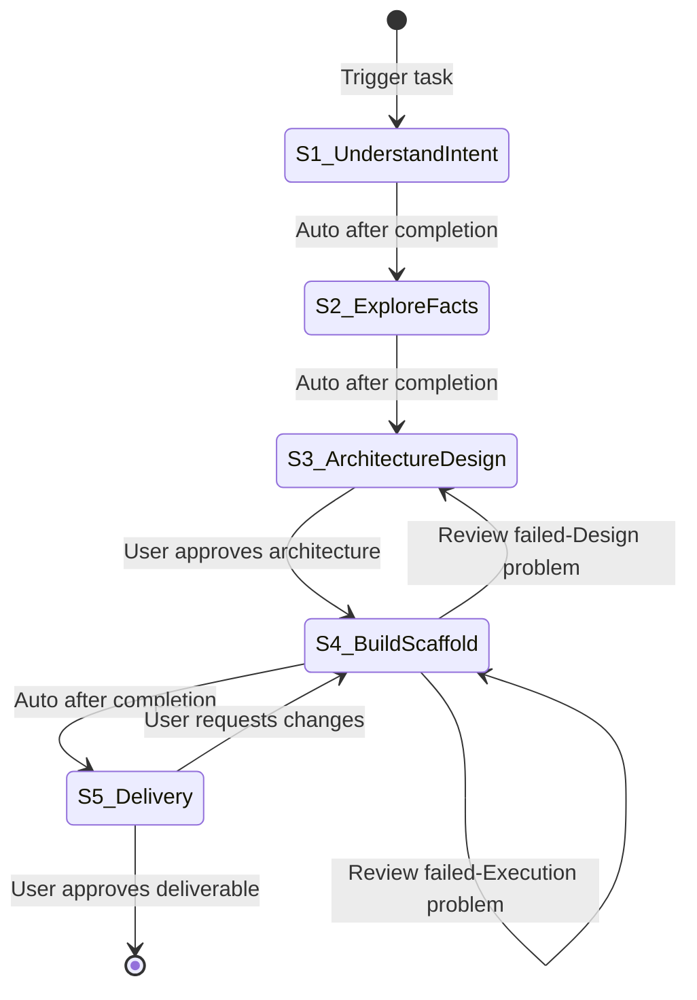

# Architecture Design

**Template ID**: `arch-design`
**Category**: development
**Description**: Architecture design and project cold-start workflow (intent → facts → architecture & layering → scaffold → delivery)
**Command**: `/pm-arch-design`
**Version**: 0.4.0

---

## Applicable Scenarios

- Architecture design for a new project or a major subsystem
- Project cold-start: designing the architecture, layering, and building the project skeleton
- Defining module boundaries, tech stack, and conventions before feature development

**Not applicable**: Single feature module design (use feat-design); existing feature modification (use spec-driven-dev).

---

## Input Requirements

| Input Item | Required | Description |
|------------|----------|-------------|
| Architecture goal | Yes | What to design and why (new project, subsystem, or restructure) |
| Constraints | No | Known technical/business constraints |

---

## Default Deliverables

- Architecture-level Spec document: system architecture overview, module division, deployment model, and main data-flow direction (deliverable of S3); detailed design is deferred to feat-design
- Project skeleton: directory structure, base config, build/test setup (deliverable of S4)

> The user may re-specify deliverables when starting a task; in S1 the LLM must re-confirm deliverables and acceptance standards with the user.

---

## State Machine

---

## Task Steps

### S1: Understand Intent

**Goal**: Accurately understand the architecture design intent and confirm deliverables.
**Output**: Clear architecture intent + confirmed deliverables and acceptance standards
**Output Checklist**: —
**Review Checklist**: —
**Output Review**: human
**Referenced Regulation**: —

1. Read the user's architecture goal, extract the core intent — what to design? why? what problem does it solve?
2. Identify covered information and preliminary gaps
3. If the intent is vague or ambiguous, clarify with the user through progressive questioning:
   - Use `question` / `confirm` blocking tools — only one question at a time
   - Wait for the user's response before asking the next question
   - If the answer leads to a new direction, follow up deeply before returning to the original path
   - Loop until the user confirms "no further questions"
   - **Never** batch multiple questions in plain text
4. Present the deliverables and acceptance standards (user-specified values if provided at task start, otherwise the defaults), and use the `confirm` tool to confirm with the user

**Upon completion**:
- Auto proceed to S2

---

### S2: Explore Facts

**Goal**: Establish a knowledge baseline for the architecture design.
**Output**: Knowledge baseline (existing code structure, constraints, conventions)
**Output Checklist**: —
**Review Checklist**: —
**Output Review**: human
**Referenced Regulation**: —

1. Explore the existing project structure (if any): modules, dependencies, build setup, conventions
2. Research external references as needed (framework docs, best practices, OSS examples)
3. If facts are vague, ambiguous, or contradictory, clarify with the user through progressive questioning:
   - Use `question` / `confirm` blocking tools — only one question at a time
   - Wait for the user's response before asking the next question
   - If the answer leads to a new direction, follow up deeply before returning to the original path
   - Loop until the user confirms "no further questions"
   - **Never** batch multiple questions in plain text
4. Document key findings and constraints (tech stack, performance, security, deployment)
5. Summarize into a knowledge baseline

**Referenced tools**: explore / librarian Agent (parallel on demand)

**Upon completion**:
- Auto proceed to S3

---

### S3: Architecture & Layering Design

**Goal**: Produce an architecture-level design (Spec document) based on confirmed preferences — architecture overview, module division, deployment model, and main data-flow direction.
**Output**: Architecture-level Spec document (architecture overview, module boundaries, deployment model, main data-flow direction; produced after confirming design preferences). Detailed interface/logic design is out of scope.
**Output Checklist**:
- Spec covers architecture-level concerns: architecture overview, module division & responsibilities, deployment model (or why it is not applicable), main data-flow direction
- Only confirmed information is written; undecided items are explicitly marked "待决策" (To be decided) with the open question
- No speculative requirements or detailed design added just to fill template sections
- Detailed design sections (interface contracts, internal logic, per-module data structures) are omitted or marked "Not Applicable" — deferred to feat-design
- All diagrams use Mermaid (no ASCII art)
- Each architecture decision traceable to S1/S2 conclusions
- Spec document follows the Spec template structure (spec-template.md), retaining only applicable sections
**Review Checklist**:
- Architecture rationality: layering and module boundaries are justified
- Module independence: no cross-module internal access
- Tech stack fits the project constraints and goals
- Design consistency: no contradictions between modules and data flow
- Scope discipline: architecture-level only — no detailed design leaking in, no requirements invented to fill template sections
**Output Review**: self-check + review-agent + human
**Referenced Regulation**: /docs/regulation/spec-template.md, /docs/regulation/constitution.md

1. Identify the key architecture decision points (tech stack, module boundaries, layering approach, deployment model, conventions)
2. For each key decision point where multiple viable options exist, present 2-3 design alternatives using the `question` tool and let the user choose the one closest to their design intent:
   - One design point at a time
   - Each alternative states its trade-offs briefly
   - Loop until all key design points are decided
   - **Never** batch multiple questions in plain text
3. Design at the architecture level based on the chosen preferences:
   - System context and architecture overview
   - Module division, responsibilities, and dependency direction
   - Deployment model (runtime units, processes, external dependencies; state why it is not applicable if the project has none)
   - Main data-flow direction between modules
   - Do NOT descend into detailed design (interface contracts, internal logic, per-module data structures) — that belongs to feat-design
4. Write the architecture Spec following the Spec template structure:
   - Fill only confirmed information; mark undecided items as "待决策" (To be decided) and state the open question
   - Omit or mark "Not Applicable" sections that belong to detailed design (e.g., detailed Interface Design, Internal Logic, feature-level Acceptance Criteria)
   - Do not invent requirements or detailed design just to fill template sections
5. Present the architecture design and use the `confirm` tool to wait for user approval

**Upon completion**:
- User approves architecture → auto proceed to S4

---

### S4: Build Project Scaffold

**Goal**: Build the project skeleton according to the approved architecture.
**Output**: Project skeleton (directory structure, base config, build/test setup, produced after confirming design preferences)
**Output Checklist**:
- Directory structure matches the approved architecture & layering
- Base config (build, test, lint) is in place and runnable
- LSP diagnostics zero error
- Build passes
**Review Checklist**:
- Scaffold matches the approved architecture design (structure, layering, config)
- No out-of-scope changes beyond the approved architecture
**Output Review**: self-check + review-agent + human
**Referenced Regulation**: /docs/regulation/constitution.md, coding_style.md

1. Create the directory structure per the approved architecture
2. Set up base config (build / test / lint) and a minimal runnable skeleton
3. Run verification (LSP diagnostics / build / test)
4. Present the scaffold summary and use the `confirm` tool to wait for acceptance (not accepted → redo per FSM rollback edge)

**Upon completion**:
- Auto proceed to S5
- Review failed-Execution problem → redo S4
- Review failed-Design problem → return to S3

---

### S5: Delivery

**Goal**: Deliverable acceptance and task closure.
**Output**: Acceptance conclusion + task closed
**Output Checklist**: —
**Review Checklist**: —
**Output Review**: human
**Referenced Regulation**: —

1. Summarize all task outputs and present the deliverables vs acceptance standards comparison
2. Use the `confirm` tool to wait for user acceptance (not accepted → return to S4 per FSM edge)
3. After acceptance, use the `question` tool to ask the user: "Execute `git commit`?"
   - If the user selects "Yes": run `git add -A && git commit`, using the architecture summary as the commit message
   - If the user selects "No": skip the commit
   - ⚠️ The user's choice does not affect task completion
4. Call `pm_task_close()` to end the task and trigger analysis

**Upon completion**:
- User approves deliverable → task ends (terminal state)
- User requests changes → return to S4