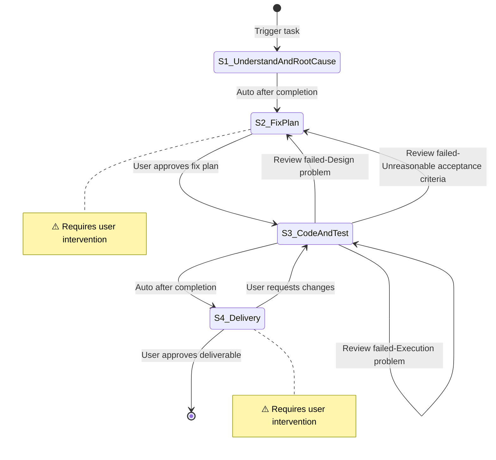

# Bug Fix

**Template ID**: `bug-fix`
**Category**: maintenance
**Description**: Standardized bug fix workflow (understand & root-cause → fix plan → code & test → deliver)
**Command**: `/pm-bug-fix`
**Version**: 0.3.0

---

## Applicable Scenarios

- Bug fixes in production or development environments
- Non-trivial fixes requiring root cause analysis
- Fixes requiring regression tests

---

## Input Requirements

| Input Item | Required | Description |
|------------|----------|-------------|
| Bug Description | Yes | Symptoms, reproduction steps, impact scope |
| Related Code/Logs | No | Information to help locate the issue |

---

## Default Deliverables

- Root cause analysis conclusion (produced in S1)
- Fix code + regression tests (produced in S3)
- Delivery report (produced in S4)

> The user may re-specify deliverables when starting a task; in S1 the LLM must re-confirm deliverables and acceptance standards with the user.

---

## State Machine

---

## Task Steps

### S1: Understand Bug and Root Cause

**Goal**: Accurately understand the bug and identify the root cause.
**Output**: Bug understanding + root cause analysis conclusion
**Output Checklist**: —
**Review Checklist**: —
**Output Review**: human
**Referenced Regulation**: —

1. Read the bug description, logs, and screenshots; confirm reproduction steps; assess impact scope (functionality, data, security)
2. If the description is unclear or ambiguous, clarify with the user through progressive questioning:
   - Use `question` / `confirm` blocking tools — only one question at a time
   - Wait for the user's response before asking the next question
   - If the answer leads to a new direction, follow up deeply before returning to the original path
   - Loop until the user confirms "no further questions"
   - **Never** batch multiple questions in plain text
3. Read relevant source code and trace the call chain to identify the root cause (cite specific file and line numbers)
4. If the observed facts are vague, ambiguous, or contradictory, clarify with the user through progressive questioning:
   - Use `question` / `confirm` blocking tools — only one question at a time
   - Wait for the user's response before asking the next question
   - If the answer leads to a new direction, follow up deeply before returning to the original path
   - Loop until the user confirms "no further questions"
   - **Never** batch multiple questions in plain text
5. Analyze test coverage: do existing tests cover this path? Why did they not catch it (weak assertions / ideal mocks / skipped tests)? Which test scenario is missing?
6. Present the root cause analysis and use the `confirm` tool to wait for user acceptance

**Upon completion**:
- User accepts root cause → auto proceed to S2

---

### S2: Design Fix Plan

**Goal**: Produce an approved fix plan with confirmed preferences and acceptance criteria.
**Output**: Fix plan (produced after confirming design preferences and acceptance criteria)
**Output Checklist**:
- Fix plan covers the confirmed root cause
- Regression test scenarios identified
- Acceptance criteria clear and verifiable
**Review Checklist**: —
**Output Review**: self-check + human
**Referenced Regulation**: —

1. Identify the key fix design decision points (fix approach, whether to add a compatibility layer, test scope)
2. For each key design point where multiple viable options exist, present 2-3 design alternatives using the `question` tool and let the user choose the one closest to their design intent:
   - One design point at a time
   - Each alternative states its trade-offs briefly
   - Loop until all key design points are decided
   - **Never** batch multiple questions in plain text
3. Confirm acceptance criteria with the user
4. Design the fix plan with the simplest viable approach: changes to make, tests to add, risk assessment
5. Present the fix plan (root cause, fix, alternatives, risks) and use the `confirm` tool to wait for approval

**Upon completion**:
- User approves fix plan → auto proceed to S3

---

### S3: Code and Test

**Goal**: Implement the approved fix and pass all verification.
**Output**: Code changes and test results
**Output Checklist**:
- LSP diagnostics zero error
- Build passes
- All tests pass, including regression tests covering the reproduction scenario
- No type escapes (any / @ts-ignore)
**Review Checklist**:
- Fix targets the confirmed root cause (no band-aid patches)
- Code is elegant and clean — follows code quality first, reduces duplication
- Regression tests adequately cover edge cases and related functionality
- No unrelated changes beyond the fix scope
**Output Review**: self-check + review-agent + human
**Referenced Regulation**: /docs/regulation/constitution.md, coding_style.md

1. Write the fix with code quality first — make the change as elegant as possible: clean, readable code that reduces duplication
2. Write regression tests: cover the reproduction scenario, edge cases, and related functionality (prevent side effects); do NOT delete failing tests
3. Run verification (LSP diagnostics / build / tests); verify the original bug scenario no longer reproduces
4. Declare output complete (call the output verification entry `pm_task_verify`); the review agent verifies the step output, then the user confirms

**Upon completion**:
- Review passed + user confirms → auto proceed to S4
- Review failed-Execution problem → redo S3
- Review failed-Design problem → return to S2
- Review failed-Unreasonable acceptance criteria → return to S2

---

### S4: Delivery

**Goal**: Deliverable acceptance and task closure.
**Output**: Acceptance conclusion + task closed
**Output Checklist**: —
**Review Checklist**: —
**Output Review**: human
**Referenced Regulation**: —

1. Present the fix report (root cause, changes, test results) and the deliverables vs acceptance standards comparison
2. Use the `confirm` tool to wait for user acceptance (not accepted → return to S3 per FSM edge)
3. Run final verification (LSP diagnostics / build / tests)
4. Use the `question` tool to ask the user: "Execute `git commit`?"
   - If the user selects "Yes": run `git add -A && git commit`, using the fix summary as the commit message
   - If the user selects "No": skip the commit
   - ⚠️ The user's choice does not affect task completion
5. Call `pm_task_close()` to end the task and trigger analysis

**Upon completion**:
- User approves deliverable → task ends (terminal state)
- User requests changes → return to S3