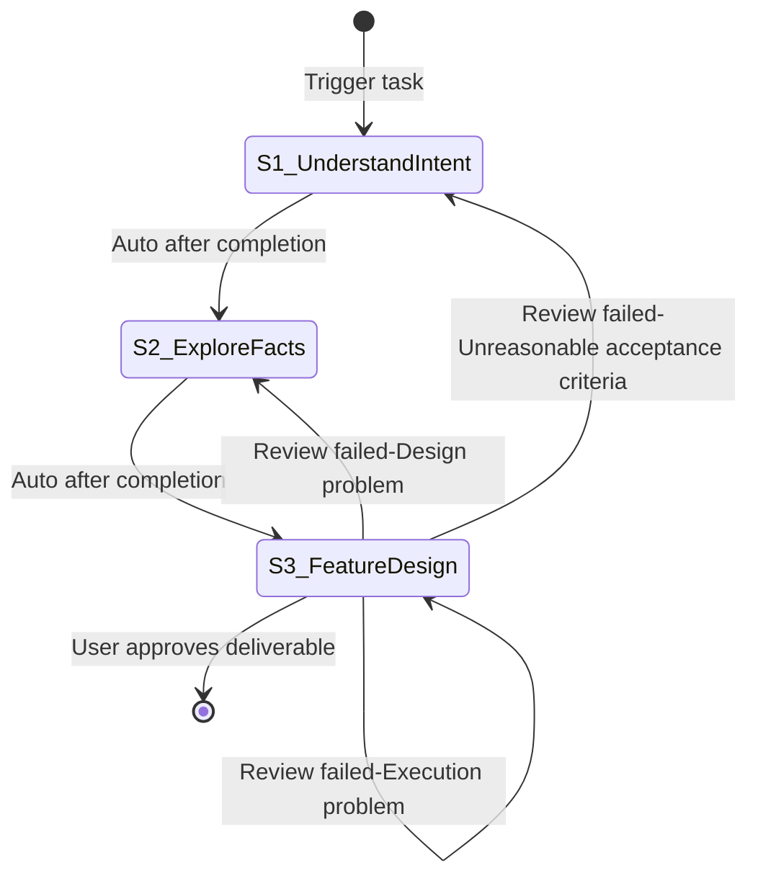

# Feature Design

**Template ID**: `feat-design`
**Category**: design
**Description**: Single feature module design workflow (intent → facts → detailed feature design)
**Command**: `/pm-feat-design`
**Version**: 0.3.0

---

## Applicable Scenarios

- Designing a single feature module (data model, interfaces, behavior) before implementation
- Translating vague feature requirements into a structured design document
- Feature-level design that will later be implemented via spec-driven-dev

**Not applicable**: Architecture design / project cold-start (use arch-design); code implementation (use spec-driven-dev).

---

## Input Requirements

| Input Item | Required | Description |
|------------|----------|-------------|
| Feature description | Yes | Feature concept, problem statement, goal summary |
| Constraints | No | Known technical/business constraints |

---

## Default Deliverables

- Feature design document (data model, interfaces, behavior, edge cases)
- Design document format reference: `regulation/spec-template.md` when producing a Spec

> The user may re-specify deliverables when starting a task; in S1 the LLM must re-confirm deliverables and acceptance standards with the user.

---

## State Machine

> **Note**: feat-design has no standalone delivery step — S3's human review handles deliverable acceptance, the git commit question, and task closure.

---

## Task Steps

### S1: Understand Intent

**Goal**: Accurately understand the feature design intent and confirm deliverables.
**Output**: Clear feature intent + confirmed deliverables and acceptance standards
**Output Checklist**: —
**Review Checklist**: —
**Output Review**: human
**Referenced Regulation**: —

1. Read the user's feature description paragraph by paragraph
2. Extract the core intent — what feature to design? what problem does it solve?
3. Identify covered information and preliminary gaps
4. If the intent is vague or ambiguous, clarify with the user through progressive questioning:
   - Use `question` / `confirm` blocking tools — only one question at a time
   - Wait for the user's response before asking the next question
   - If the answer leads to a new direction, follow up deeply before returning to the original path
   - Loop until the user confirms "no further questions"
   - **Never** batch multiple questions in plain text
5. Present the deliverables and acceptance standards (user-specified values if provided at task start, otherwise the defaults), and use the `confirm` tool to confirm with the user

**Upon completion**:
- Auto proceed to S2

---

### S2: Explore Facts

**Goal**: Establish a knowledge baseline for the feature design.
**Output**: Knowledge baseline (relevant existing code, conventions, constraints)
**Output Checklist**: —
**Review Checklist**: —
**Output Review**: human
**Referenced Regulation**: —

1. Explore related code and documents within the project (existing modules, data models, conventions)
2. Research external references as needed (framework docs, best practices, OSS examples)
3. If facts are vague, ambiguous, or contradictory, clarify with the user through progressive questioning:
   - Use `question` / `confirm` blocking tools — only one question at a time
   - Wait for the user's response before asking the next question
   - If the answer leads to a new direction, follow up deeply before returning to the original path
   - Loop until the user confirms "no further questions"
   - **Never** batch multiple questions in plain text
4. Document key findings and constraints
5. Summarize into a knowledge baseline

**Referenced tools**: explore / librarian Agent (parallel on demand)

**Upon completion**:
- Auto proceed to S3

---

### S3: Detailed Feature Design

**Goal**: Produce the detailed feature design based on confirmed preferences.
**Output**: Feature design deliverable (data model, interfaces, behavior, edge cases; produced after confirming design preferences)
**Output Checklist**:
- Design covers all confirmed requirements and known edge cases (each mapped)
- Acceptance criteria are clear and verifiable
- No out-of-scope design beyond the confirmed intent
**Review Checklist**:
- Interfaces are explicit (inputs, outputs, types, boundary conditions)
- Design aligns with existing project patterns and constraints
- Design consistency: data model, interfaces, and behavior have no contradictions
- Edge cases adequately covered
**Output Review**: self-check + review-agent + human
**Referenced Regulation**: /docs/regulation/spec-template.md

1. Identify the key feature design decision points (scope, interface style, data model approach, edge-case handling strategy)
2. For each key design point where multiple viable options exist, present 2-3 design alternatives using the `question` tool and let the user choose the one closest to their design intent:
   - One design point at a time
   - Each alternative states its trade-offs briefly
   - Loop until all key design points are decided
   - **Never** batch multiple questions in plain text
3. Design the feature based on the chosen preferences: data model, interfaces, behavior flow, edge cases
4. Write the feature design document (Spec format when applicable)
5. Present the design summary and use the `confirm` tool to wait for user acceptance (not accepted → redo per FSM rollback edge)
6. After acceptance, use the `question` tool to ask the user: "Execute `git commit`?"
   - If the user selects "Yes": run `git add -A && git commit`, using the design summary as the commit message
   - If the user selects "No": skip the commit
   - ⚠️ The user's choice does not affect task completion
7. Call `pm_task_close()` to end the task and trigger analysis

**Upon completion**:
- User approves deliverable → task ends (terminal state)
- Review failed-Execution problem → redo S3
- Review failed-Design problem → return to S2
- Review failed-Unreasonable acceptance criteria → return to S1