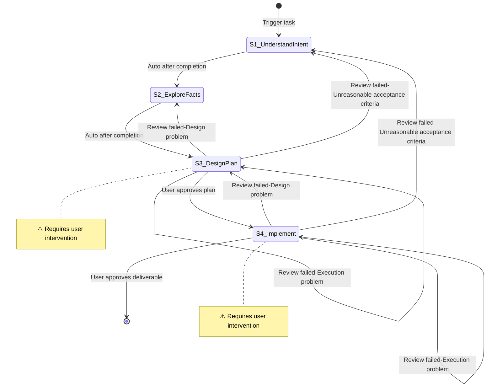

# {Flow Name}

**Template ID**: `{flow-name}`
**Category**: {category}
**Description**: {description}
**Command**: `/pm-{flow-name}`
**Version**: 1.0.0

---

## Applicable Scenarios

{One sentence describing what task types this flow applies to}

---

## Input Requirements

| Input Item | Required | Description |
|------------|----------|-------------|
| {field name} | Yes/No | {description} |

---

## Default Deliverables

- {deliverable 1}
- {deliverable 2}

> The user may re-specify deliverables when starting a task; in S1 the LLM must re-confirm deliverables and acceptance standards with the user.

---

## State Machine

> **Convention**:
> - Step nodes are written as `S{n}_name` (e.g. `S1_UnderstandIntent`), mapping to step number `S{n}` in the Task Steps section.
> - Use mermaid `note` to mark steps that require user intervention.
> - Use labels to describe transition conditions on each edge.
> - Rollback edges (review failure) MUST be explicitly defined in the diagram, with edge label format `Review failed-{reason}`. The `{reason}` is one of: `Execution problem` / `Design problem` / `Unreasonable acceptance criteria`.

---

## Task Steps

### S1: {Step Name}

**Goal**: {One sentence describing the step's objective}
**Output**: {The step's execution target}
**Output Checklist**: —
**Output Review**: human
**Referenced Regulation**: {—, or /docs/regulation/filenames comma-separated}

1. {What to do first}
2. {What to do second}

**Upon completion**:
- Auto proceed to S2

---

### S2: {Step Name}

**Goal**: {One sentence describing the step's objective}
**Output**: {The step's execution target}
**Output Checklist**:
- {Self-check item 1}
- {Self-check item 2}
**Output Review**: self-check + human
**Referenced Regulation**: {—, or /docs/regulation/filenames comma-separated}

1. {What to do first}
2. {What to do second}

**Upon completion**:
- Auto proceed to S3

---

{Add more steps as needed}

> **Step Format Convention**:
> - Each step block uses these field keys, in this order: `**Goal**`, `**Output**`, `**Output Checklist**`, `**Output Review**`, `**Referenced Regulation**`, then the numbered instruction list, then `**Upon completion**`
> - `**Goal**` (required): one sentence describing the step's objective
> - `**Output**` (required): the step's execution target
> - `**Output Checklist**` (required when `**Output Review**` includes `self-check`, otherwise `—`): bullet list of self-check items
> - `**Output Review**` (required): enum combination of `self-check` / `review-agent` / `human`, joinable with `+`
> - `**Referenced Regulation**` (optional): comma-separated file paths, or `—` if none
> - `**Upon completion**` (required): bullet list matching the FSM outgoing edges — one line per edge in `{condition} → {target step}` format
> - Field keys are English and MUST NOT be translated to Chinese. Documents using Chinese keys (e.g. `目标` / `完成后`) are treated as legacy 0.1 format.
> - `⚠️` placed after the step name + blockquote = step requiring user intervention
