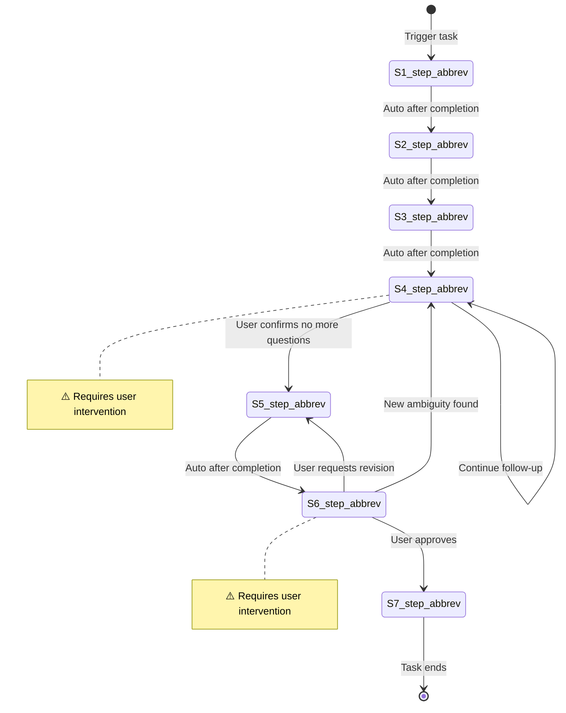

# {Flow Name}

**Template ID**: `{flow-name}`
**Category**: {category}
**Description**: {description}
**Command**: `/pm-{flow-name}`
**Version**: 1.0.0

---

## Applicable Scenarios

{One sentence describing what task types this flow applies to}

---

## Input Requirements

| Input Item | Required | Description |
|------------|----------|-------------|
| {field name} | Yes/No | {description} |

---

## Default Deliverables

- {deliverable 1}
- {deliverable 2}

---

## State Machine

> **Convention**: Use mermaid `note` to mark steps that require user intervention. Use labels to describe transition conditions on each edge.

---

## Task Steps

### S1: {Step Name}

**Goal**: {The goal this step must achieve}
**Execution Agent**: {Specified Agent}
**Referenced Regulation**: {/docs/regulation/filenames, comma-separated, omit if none}

1. {What to do first}
2. {What to do second}

**Upon completion**: Auto proceed to S2

---

### S2: {Step Name}

**Goal**: {The goal this step must achieve}
**Execution Agent**: {Specified Agent}
**Referenced Regulation**: {—}

1. {What to do}

**Upon completion**: Auto proceed to S3

---

### S3: [Human-in-loop] {Step Name} ⚠️

> **⚠️ This step requires user intervention.** Use `question` / `confirm` blocking tools to ask the user — only 1 question at a time, wait for reply before continuing.

**Goal**: {The goal this step must achieve}

1. Use `question` / `confirm` tools to progressively clarify with the user
2. Only 1 question at a time
3. Loop until user confirms no more questions

**Upon completion**: User confirms "no more questions" → S4

---

{Add more steps as needed}

> **Step Format Convention**:
> - `⚠️` placed after step name + blockquote = step requiring user intervention
> - `**Upon completion**` describes the transition condition to the next step
> - `**Goal**` is a required metadata field
> - `**Execution Agent**` is optional
> - `**Referenced Regulation**` is optional
