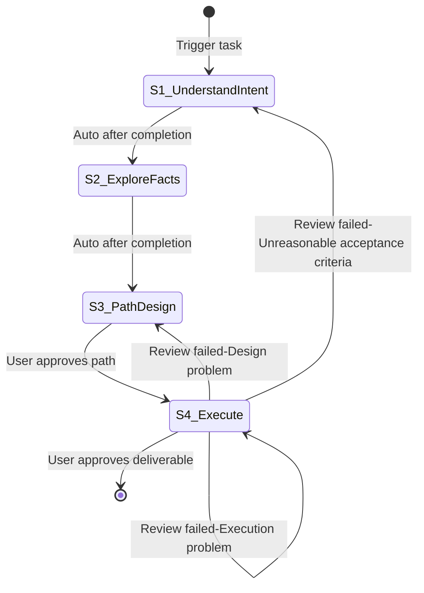

# Research Task

**Template ID**: `research`
**Category**: research
**Description**: Research workflow for organizing requirements, design documents, and analysis
**Command**: `/pm-research`
**Version**: 0.3.0

---

## Applicable Scenarios

- Organizing requirements, maintaining documentation
- Research analysis, investigating open-ended questions
- Designing and writing Spec documents, technical proposals

**Not applicable**: Code implementation, bug fixes.

---

## Input Requirements

| Input Item | Required | Description |
|------------|----------|-------------|
| Requirement description / draft / initial idea | Yes | Describe the problem to solve or the goal to achieve |

If the input does not meet requirements, guide the user to supplement before continuing.

---

## Default Deliverables

- Research report / Spec document / Technical proposal
- If a planning phase is involved, output the plan document to `docs/plan/plan-*.md`

> The user may re-specify deliverables when starting a task; in S1 the LLM must re-confirm deliverables and acceptance standards with the user.

---

## State Machine

> **Note**: research has no standalone delivery step — S4's human review handles deliverable acceptance, the git commit question, and task closure.

---

## Task Steps

### S1: Understand Intent

**Goal**: Accurately understand the core intent of the user's input and confirm deliverables.
**Output**: Clear task intent + confirmed deliverables and acceptance standards
**Output Checklist**: —
**Review Checklist**: —
**Output Review**: human
**Referenced Regulation**: —

1. Read the user-provided description paragraph by paragraph
2. Extract the core intent — what problem to solve? What goal to achieve?
3. Identify covered information and preliminary gaps
4. If the intent is vague or ambiguous, clarify with the user through progressive questioning:
   - Use `question` / `confirm` blocking tools — only one question at a time
   - Wait for the user's response before asking the next question
   - If the answer leads to a new direction, follow up deeply before returning to the original path
   - Loop until the user confirms "no further questions"
   - **Never** batch multiple questions in plain text
5. Present the deliverables and acceptance standards (user-specified values if provided at task start, otherwise the defaults), and use the `confirm` tool to confirm with the user

**Upon completion**:
- Auto proceed to S2

---

### S2: Explore Facts

**Goal**: Search for relevant internal and external information to establish a knowledge baseline.
**Output**: Knowledge baseline (list of known facts)
**Output Checklist**: —
**Review Checklist**: —
**Output Review**: human
**Referenced Regulation**: —

1. Search for existing relevant documents and code within the project
2. Search for external reference materials (documentation, best practices, open-source implementations)
3. If facts are vague, ambiguous, or contradictory, clarify with the user through progressive questioning:
   - Use `question` / `confirm` blocking tools — only one question at a time
   - Wait for the user's response before asking the next question
   - If the answer leads to a new direction, follow up deeply before returning to the original path
   - Loop until the user confirms "no further questions"
   - **Never** batch multiple questions in plain text
4. Document key findings and constraints
5. Summarize findings to establish a knowledge baseline

**Referenced tools**: explore / librarian Agent (parallel on demand)

**Upon completion**:
- Auto proceed to S3

---

### S3: Design Execution Path

**Goal**: Design the execution path based on clarified requirements and confirmed preferences.
**Output**: Execution path plan (produced after confirming design preferences)
**Output Checklist**: —
**Review Checklist**: —
**Output Review**: human
**Referenced Regulation**: —

1. Identify the key design decision points of the execution path (approach, scope, deliverable format, subtask breakdown strategy)
2. For each key design point where multiple viable options exist, present 2-3 design alternatives using the `question` tool and let the user choose the one closest to their design intent:
   - One design point at a time
   - Each alternative states its trade-offs briefly
   - Loop until all key design points are decided
   - **Never** batch multiple questions in plain text
3. Design the execution path based on the chosen preferences: outline the complete plan — modules, steps, data flow, edge-case handling
4. Break down tasks into independently executable and verifiable subtasks, noting dependencies and parallelization opportunities
5. Present the path design and use the `confirm` tool to wait for approval

**Upon completion**:
- User approves path → auto proceed to S4

---

### S4: Execute

**Goal**: Execute the approved path and produce the final deliverables.
**Output**: Specified deliverable (research report / Spec document / technical proposal)
**Output Checklist**:
- The deliverable answers the research question / covers all confirmed requirements (each mapped)
- Conclusions are supported by the gathered facts with sources noted
- Edge cases and constraints identified in S2/S3 are addressed
- No out-of-scope changes beyond the approved path
**Review Checklist**: —
**Output Review**: self-check + human
**Referenced Regulation**: —

1. Execute subtasks in the planned order to produce the final deliverable
2. Mark subtasks with `[P]` for parallel processing; update progress after completing each subtask
3. Consolidate all outputs and present a summary of the final deliverable
4. Use the `confirm` tool to wait for user acceptance (not accepted → redo per FSM rollback edge)
5. After acceptance, use the `question` tool to ask the user: "Execute `git commit`?"
   - If the user selects "Yes": run `git add -A && git commit`, using the research summary as the commit message
   - If the user selects "No": skip the commit
   - ⚠️ The user's choice does not affect task completion
6. Call `pm_task_close()` to end the task and trigger analysis

**Upon completion**:
- User approves deliverable → task ends (terminal state)
- Review failed-Execution problem → redo S4
- Review failed-Design problem → return to S3
- Review failed-Unreasonable acceptance criteria → return to S1