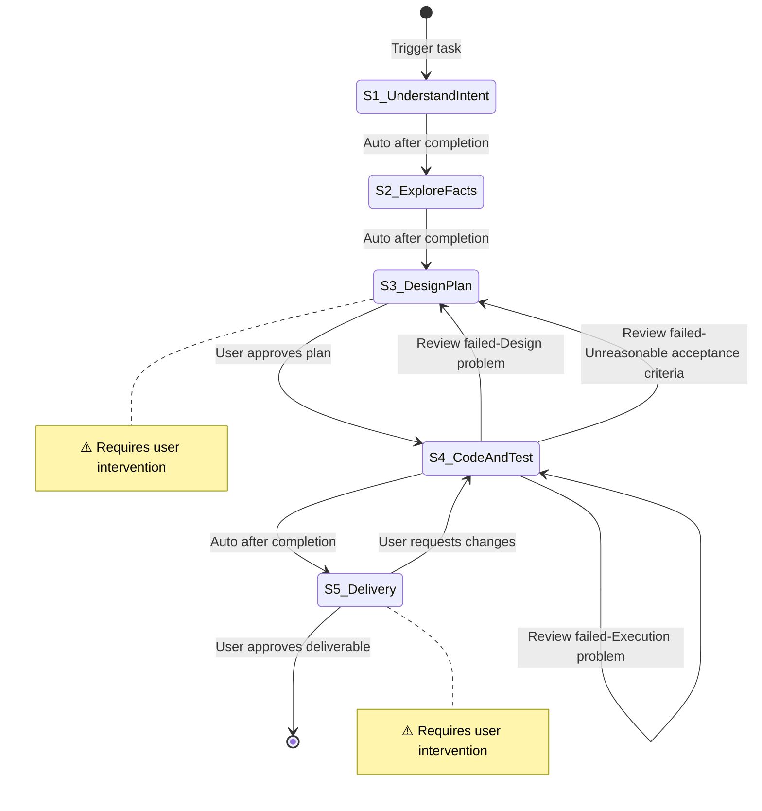

# Quick Turnaround Tasks

**Template ID**: `side-job`
**Category**: side-job
**Description**: Quick turnaround task flow — LLM must confirm the plan with the user before execution
**Command**: `/pm-side-job`
**Version**: 0.3.0

---

## Applicable Scenarios

- Independent small tasks with clear intent that don't require deep research
- One-off modifications, config adjustments, small-scale refactoring, script writing, etc.
- Users expect the LLM to think through a plan and get confirmation before taking action

**Not applicable**: Complex architecture design, bug fixes requiring root cause analysis, large-scale refactoring.

---

## Input Requirements

| Input Item | Required | Description |
|------------|----------|-------------|
| Task Description | Yes | What to do, and the expected outcome |

If the input does not meet requirements, guide the user to supplement before continuing.

---

## Default Deliverables

- Complete the task described by the user
- If code changes are involved, pass LSP diagnostics, build, and test verification

> The user may re-specify deliverables when starting a task; in S1 the LLM must re-confirm deliverables and acceptance standards with the user.

---

## State Machine

---

## Task Steps

### S1: Understand Intent

**Goal**: Accurately understand what the user wants to do, and confirm deliverables.
**Output**: Clear intent + confirmed deliverables and acceptance standards
**Output Checklist**: —
**Review Checklist**: —
**Output Review**: human
**Referenced Regulation**: —

1. Read the user's description, extract the core task and constraints
2. Read relevant source code and documentation as needed (using the read tool directly)
3. Search for related files within the project to understand existing patterns (using explore agent for parallel searches)
4. If the description is unclear or ambiguous, clarify with the user through progressive questioning:
   - Use `question` / `confirm` blocking tools — only one question at a time
   - Wait for the user's response before asking the next question
   - If the answer leads to a new direction, follow up deeply before returning to the original path
   - Loop until the user confirms "no further questions"
   - **Never** batch multiple questions in plain text
5. Present the deliverables and acceptance standards (user-specified values if provided at task start, otherwise the defaults), and use the `confirm` tool to confirm with the user

**Note**: **Do not** edit, create, or delete any files during this step.

**Upon completion**:
- Auto proceed to S2

---

### S2: Explore Facts

**Goal**: Establish a knowledge baseline for the task.
**Output**: Knowledge baseline (known facts and constraints)
**Output Checklist**: —
**Review Checklist**: —
**Output Review**: human
**Referenced Regulation**: —

1. Explore related code and documents within the project to understand existing patterns
2. If facts are vague, ambiguous, or contradictory, clarify with the user through progressive questioning:
   - Use `question` / `confirm` blocking tools — only one question at a time
   - Wait for the user's response before asking the next question
   - If the answer leads to a new direction, follow up deeply before returning to the original path
   - Loop until the user confirms "no further questions"
   - **Never** batch multiple questions in plain text
3. Consider 2-3 feasible approaches, evaluate each in terms of scope of changes, risk, and impact
4. Document key findings and constraints into a knowledge baseline

**Upon completion**:
- Auto proceed to S3

---

### S3: Design Plan

**Goal**: Produce an approved execution plan with confirmed preferences and acceptance criteria.
**Output**: Design plan (produced after confirming design preferences and acceptance criteria)
**Output Checklist**:
- Plan covers the full task description
- Acceptance criteria clear and verifiable
- No out-of-scope changes beyond the task
**Review Checklist**: —
**Output Review**: self-check + human
**Referenced Regulation**: —

1. Identify the key design decision points of the task (technical approach / implementation preference, scope boundary)
2. For each key design point where multiple viable options exist, present 2-3 design alternatives using the `question` tool and let the user choose the one closest to their design intent:
   - One design point at a time
   - Each alternative states its trade-offs briefly
   - Loop until all key design points are decided
   - **Never** batch multiple questions in plain text
3. Confirm acceptance criteria with the user
4. Design the execution plan, including at minimum:
   - **Task Understanding**: A one-sentence summary of what to do
   - **Execution Steps**: Which specific files to modify, what changes to make (order and dependencies)
   - **Scope of Impact**: Modules or features that may be affected
   - **Risk Points**: Areas to watch out for (if any)
   - Follow existing project patterns identified in S2
5. ⚠️ Use the `confirm` / `question` tools to wait for the user's explicit confirmation:
   - **Must** receive a **strongly affirmative** instruction such as "confirmed / agree / approved / no problem / OK / go ahead / LGTM" before proceeding
   - Vague or weakly affirmative language ("looks doable", "give it a try", "mm", "should be fine") is treated as **unconfirmed** — must follow up with the user for a clear stance
6. **Strictly prohibited** from performing any code modifications, file edits, or todo creation before receiving explicit confirmation

**Upon completion**:
- User explicitly confirms → auto proceed to S4

---

### S4: Code and Test

**Goal**: Execute the approved plan and pass all verification.
**Output**: Code changes and test results
**Output Checklist**:
- LSP diagnostics zero error
- Build passes
- Tests pass (where applicable)
- No type escapes (any / @ts-ignore)
- Change scope matches the plan
**Review Checklist**:
- Code quality: elegant, readable, no duplication
- Implementation follows the plan confirmed in S3
- No unnecessary refactoring or hidden changes
**Output Review**: self-check + review-agent + human
**Referenced Regulation**: /docs/regulation/constitution.md, coding_style.md

1. Create a todo list (if the task involves multiple sub-steps)
2. Strictly follow the plan confirmed in S3:
   - Only modify files listed in the plan
   - Do not introduce changes outside the plan
   - Follow the project constitution's "Code Quality First" principle
3. Update todo status upon completing each sub-step
4. Run verification (LSP diagnostics / build / type check / tests)
5. Declare output complete (call the output verification entry `pm_task_verify`); the review agent verifies the step output, then the user confirms

**Upon completion**:
- Review passed + user confirms → auto proceed to S5
- Review failed-Execution problem → redo S4
- Review failed-Design problem → return to S3
- Review failed-Unreasonable acceptance criteria → return to S3

---

### S5: Delivery

**Goal**: Deliverable acceptance and task closure.
**Output**: Acceptance conclusion + task closed
**Output Checklist**: —
**Review Checklist**: —
**Output Review**: human
**Referenced Regulation**: —

1. Present an execution summary:
   - Which files were modified
   - What changes were made (diff summary)
   - Verification results (build / type check / LSP diagnostics passed or not)
2. Present the deliverables vs acceptance standards comparison; use the `confirm` / `question` tools to wait for the user's acceptance confirmation (not accepted → return to S4 per FSM edge)
3. After acceptance, use the `question` tool to ask the user: "Proceed with `git commit`?"
   - If the user chooses "Yes": run `git add -A && git commit`, using the task summary as the commit message
   - If the user chooses "No": skip the commit
   - ⚠️ The user's choice does not affect task completion
4. Call `pm_task_close()` to end the task and trigger analysis

**Upon completion**:
- User approves deliverable → task ends (terminal state)
- User requests changes → return to S4