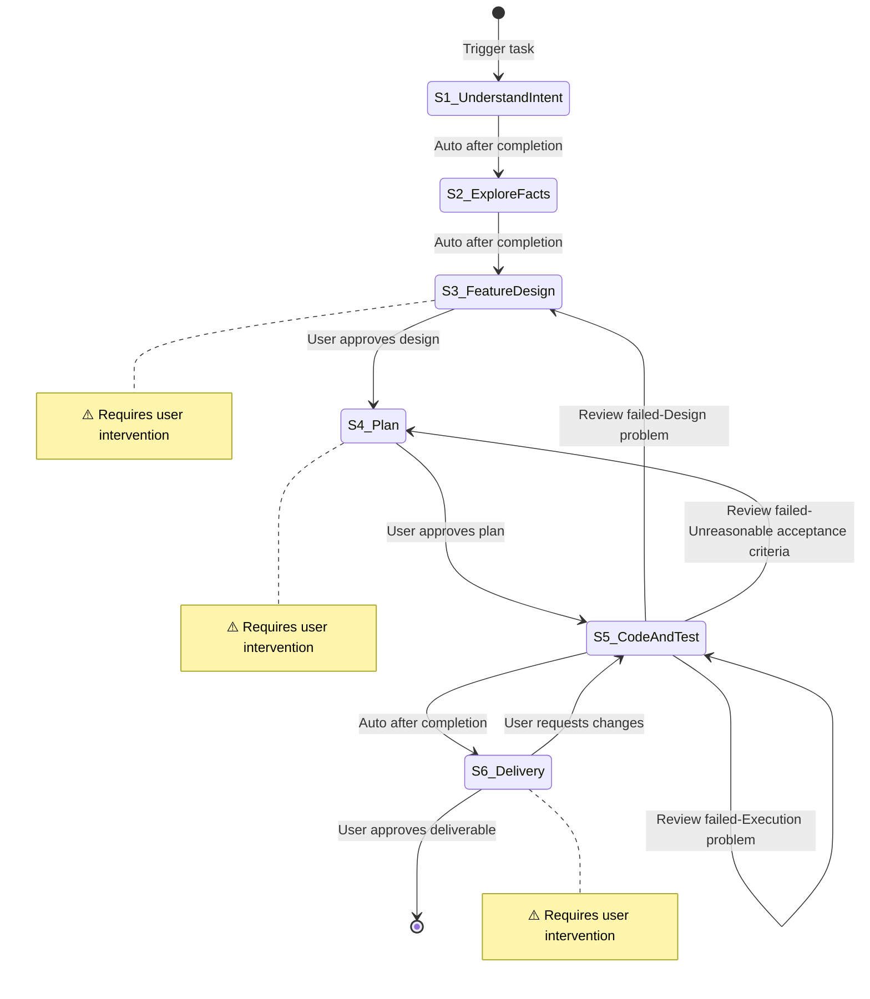

# Spec-Driven Development

**Template ID**: `spec-driven-dev`
**Category**: development
**Description**: Spec-driven standardized development workflow (Understand/Design/Plan/Code/Test/Deliver, 6 steps)
**Command**: `/pm-spec-driven-dev`
**Version**: 0.2.0

---

## Applicable Scenarios

- Medium-to-large new feature development
- Tasks involving multi-module interaction
- Complex tasks requiring requirement clarification
- Feature modification with an existing Spec document

---

## Input Requirements

| Input Item | Required | Description |
|------------|----------|-------------|
| Spec Document | No | Existing specification document (read when present; write/update during S3) |
| Change Request | Yes | What to change and why |

---

## Default Deliverables

- Updated Spec document (feature design, produced in S3)
- Code implementation + test code (produced in S5)
- Delivery report (produced in S6)

> The user may re-specify deliverables when starting a task; in S1 the LLM must re-confirm deliverables and acceptance standards with the user.

---

## State Machine

---

## Task Steps

### S1: Understand Intent

**Goal**: Accurately understand the change intent, current code state, and delivery requirements.
**Output**: Clear development intent + confirmed deliverables and acceptance standards
**Output Checklist**: —
**Output Review**: human
**Referenced Regulation**: —

1. Read the user-submitted change request
2. Extract core intent — what needs to change? why?
3. Locate and read the corresponding Spec document from the `docs/spec/` directory (do NOT skip this step), then read related source code
4. Mark covered, vague, and missing information
5. If the intent is vague or ambiguous, clarify with the user through progressive questioning:
   - Use `question` / `confirm` blocking tools — only one question at a time
   - Wait for the user's response before asking the next question
   - If the answer leads to a new direction, follow up deeply before returning to the original path
   - Loop until the user confirms "no further questions"
   - **Never** batch multiple questions in plain text
6. Present the deliverables and acceptance standards (user-specified values if provided at task start, otherwise the defaults), and use the `confirm` tool to confirm with the user

**Upon completion**:
- Auto proceed to S2

---

### S2: Explore Facts

**Goal**: Establish a knowledge baseline of requirements, gaps, and constraints.
**Output**: Knowledge baseline (facts, gaps, and constraints)
**Output Checklist**: —
**Output Review**: human
**Referenced Regulation**: —

1. Cross-reference the Spec against the change request, marking missing items, vague items, and contradictions
2. Sort gaps by impact level
3. Clarify ambiguous points with the user through progressive questioning:
   - Use `question` / `confirm` blocking tools — only one question at a time
   - Wait for the user's response before asking the next question
   - If the answer leads to a new direction, follow up deeply before returning to the original path
   - Loop until the user confirms "no further questions"
   - **Never** batch multiple questions in plain text
4. Re-analyze the gap list based on clarified answers; if new questions emerge, continue interviewing; otherwise consolidate the knowledge baseline

**Upon completion**:
- Auto proceed to S3

---

### S3: Detailed Feature Design

**Goal**: Produce the feature design (and update the Spec document) based on confirmed preferences.
**Output**: Feature design (produced after confirming design preferences; Spec document updated)
**Output Checklist**:
- Design covers all clarified requirements
- Third-party dependency skills verified before design finalization
- Design aligns with existing project patterns
- Spec document updated to reflect the confirmed design (every change traceable to an interview conclusion)
**Output Review**: self-check + human
**Referenced Regulation**: /docs/regulation/spec-template.md

1. Identify the key feature design decision points (tech selection, interface style, data model approach, implementation approach)
2. For each key design point where multiple viable options exist, present 2-3 design alternatives using the `question` tool and let the user choose the one closest to their design intent:
   - One design point at a time
   - Each alternative states its trade-offs briefly
   - Loop until all key design points are decided
   - **Never** batch multiple questions in plain text
3. Design the feature based on the chosen preferences: data model, interfaces, behavior, edge cases
4. Update the Spec document to reflect the confirmed design (modify / add / delete sections; keep Spec consistent; traceability to interview conclusions)
5. Present the design summary and use the `confirm` tool to wait for user approval

**Upon completion**:
- User approves design → auto proceed to S4

---

### S4: Plan

**Goal**: Produce an execution plan based on the approved design and confirmed acceptance criteria.
**Output**: Execution plan (produced after confirming acceptance criteria)
**Output Checklist**:
- File list is complete; each change maps to a Spec section
- Test cases cover all change points
- Risks have corresponding mitigations
- Plan saved to `docs/plan/plan-{taskId}.md`
**Output Review**: self-check + human
**Referenced Regulation**: —

1. Confirm acceptance criteria with the user: present the proposed acceptance criteria for each change point and use the `confirm` / `question` tools to finalize them
2. Read relevant source code and design code change points for each confirmed Spec change
3. Design test cases for each change point
4. Perform Spec vs code conflict analysis (interface mismatches, constraint gaps, terminology drift); annotate a recommended alignment direction for each conflict
5. Save the Plan as a file `docs/plan/plan-{taskId}.md` (S5 and S6 depend on it)
6. Present the Plan (code changes + conflict points) and use the `confirm` tool to wait for user approval; for each conflict point, use the `question` tool to ask the user for the alignment direction

**Upon completion**:
- User approves plan → auto proceed to S5

---

### S5: Code and Test

**Goal**: Implement per the approved plan, write tests, and pass all verification.
**Output**: Code changes and test results
**Output Checklist**:
- LSP diagnostics zero error
- Build passes
- All tests pass
- No type escapes (any / @ts-ignore)
- Change scope matches the plan
**Output Review**: self-check + review-agent + human
**Referenced Regulation**: /docs/regulation/constitution.md, coding_style.md, checklist.md

1. Implement change points from the Plan one by one (run build/type-check after each change)
2. Write tests according to the Plan's test cases; run tests and fix failures; do NOT delete failing tests
3. Perform self-check: all Plan tasks implemented, build + tests pass, Spec fully implemented, no unnecessary refactoring
4. Run the code review phase (if `/code-review-skill` is available) and output a severity-classified review report; fix critical items
5. Declare output complete (call the output verification entry `pm_task_verify`); the review agent verifies the step output, then the user confirms

**Upon completion**:
- Review passed + user confirms → auto proceed to S6
- Review failed-Execution problem → redo S5
- Review failed-Design problem → return to S3
- Review failed-Unreasonable acceptance criteria → return to S4

---

### S6: Delivery

**Goal**: Deliverable acceptance and task closure.
**Output**: Acceptance conclusion + task closed
**Output Checklist**: —
**Output Review**: human
**Referenced Regulation**: /docs/regulation/checklist.md

1. Summarize all task outputs; update the Spec document's Implementation Plan section to reflect actual changes
2. Present the deliverables vs acceptance standards comparison; use the `confirm` tool to wait for user acceptance (not accepted → return to S5 per FSM edge)
3. Run final verification (LSP diagnostics / build / tests)
4. Use the `question` tool to ask the user: "Execute `git commit`?"
   - If the user selects "Yes": run `git add -A && git commit`, using the development summary as the commit message
   - If the user selects "No": skip the commit
   - ⚠️ The user's choice does not affect task completion
5. Call `pm_task_close()` to end the task and trigger analysis

**Upon completion**:
- User approves deliverable → task ends (terminal state)
- User requests changes → return to S5