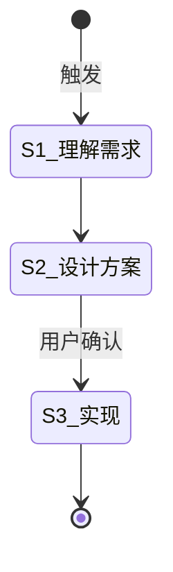

# 旧格式测试流程

**Template ID**: `v1-legacy`
**Command**: `/pm-v1-legacy`
**Version**: 1.0.0

---

## 适用场景

用于 0.1 格式兼容性测试。

---

## 状态机

---

## 任务步骤

### S1: 理解需求

**目标**：理解任务意图。
**引用 Regulation**：—

1. 阅读需求

**完成后**：自动进入 S2

---

### S2: 设计方案

**目标**：设计技术方案。

1. 设计方案

**完成后**：自动进入 S3

---

### S3: 实现

**目标**：按方案实现。

1. 实现

**完成后**：任务结束
