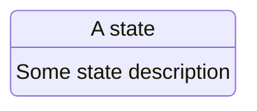

# V2 Broken FSM Test Flow

**Template ID**: `v2-bad-fsm`
**Category**: test
**Description**: 0.2 format flow with a malformed FSM diagram
**Command**: `/pm-v2-bad-fsm`
**Version**: 2.0.0

---

## Applicable Scenarios

- FSM degradation unit tests

---

## State Machine

---

## Task Steps

### S1: Understand Intent

**Goal**: Understand the task intent
**Output**: Confirmed intent
**Output Checklist**: —
**Output Review**: human
**Referenced Regulation**: —

1. Read the request

**Upon completion**: Auto proceed to S2

---

### S2: Execute

**Goal**: Execute the task
**Output**: Execution result
**Output Checklist**: —
**Output Review**: human
**Referenced Regulation**: —

1. Execute

**Upon completion**: End
