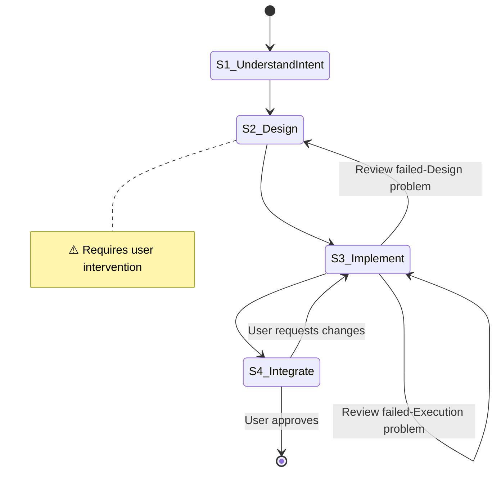

# V2 Test Flow

**Template ID**: `v2-full`
**Category**: test
**Description**: 0.2 format test flow with full FSM
**Command**: `/pm-v2-full`
**Version**: 2.0.0

---

## Applicable Scenarios

- FSM validation unit tests

---

## Input Requirements

| Input Item | Required | Description |
|------------|----------|-------------|
| Task | Yes | The task |

---

## Default Deliverables

- Code changes + tests passing

---

## State Machine

---

## Task Steps

### S1: Understand Intent

**Goal**: Understand the task intent
**Output**: Confirmed intent + deliverables
**Output Checklist**: —
**Output Review**: human
**Referenced Regulation**: —

1. Read the request
2. Confirm with user

**Upon completion**: Auto proceed to S2

---

### S2: Design

**Goal**: Produce a confirmed design
**Output**: Design document
**Output Checklist**:
- Covers all points
- Follows project patterns
**Output Review**: self-check + human
**Referenced Regulation**: constitution.md, coding_style.md

1. Design the solution

**Upon completion**: User confirms → S3

---

### S3: [Human-in-loop] Implement ⚠️

**Goal**: Implement per design
**Output**: Code changes + test results
**Output Checklist**:
- LSP diagnostics clean
- Build passes
- Tests pass
**Output Review**: self-check + review-agent + human
**Referenced Regulation**: —

1. Implement
2. Run verification

**Upon completion**: Review passes → S4

---

### S4: Integrate

**Goal**: Acceptance and task close
**Output**: Acceptance result
**Output Checklist**: —
**Output Review**: human
**Referenced Regulation**: —

1. Show deliverables
2. Confirm acceptance

**Upon completion**: User approves → end
